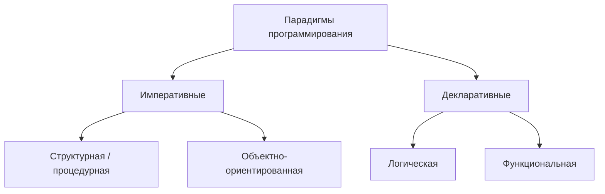

# Абстракция и инкапсуляция

> [!abstract] О чём заметка
> Заметка объясняет, что такое объектно-ориентированное программирование (ООП), откуда оно взялось и на каких четырёх принципах держится. Подробно разбираются первые два принципа: **абстракция** (выбираем в моделируемой сущности только нужное для задачи) и **инкапсуляция** (скрываем устройство класса за небольшим публичным интерфейсом). Эти идеи отвечают на вопрос, *как проектировать* классы из темы [[02 Классы и объекты]], а не только как их писать.

## Что такое ООП и парадигмы программирования

**ООП — объектно-ориентированное программирование (object-oriented programming, OOP)** — это *парадигма программирования*.

> [!note] Определение
> **Парадигма программирования** — это метод организации программ. Она определяет, какие «строительные блоки» (компоненты) мы используем, как структурируем программу и как связываем компоненты в единую систему.

ООП — не единственная парадигма. Их делят на две большие ветви:



| Ветвь | Что описывает код | Примеры |
|---|---|---|
| **Императивная** (imperative) | *как* решать задачу: последовательность команд | структурная, объектно-ориентированная |
| **Декларативная** (declarative) | *какую* задачу решить; способ выбирает среда выполнения | логическая (Prolog), функциональная (Haskell), запросы SQL |

В курсе нас интересуют императивные парадигмы.

### Структурная парадигма

До сих пор мы писали в **структурной (процедурной) парадигме**: основной строительный блок — **функция**, а функции состоят из команд. Функции решают отдельные задачи и вызывают друг друга (см. [[05 Функции и рекурсия]]).

### Объектно-ориентированная парадигма

В ООП основной блок — **объект**, то есть экземпляр класса. Класс — шаблон, описывающий *структуру* (из чего состоит) и *поведение* (что умеет) объекта. Программа — множество объектов, общающихся между собой: одни создают другие, обращаются к их полям и методам. Объекты могут быть экземплярами разных классов.

У объекта выделяют:

- **состояние** (state), или атрибуты — значения его полей;
- **поведение** (behaviour) — его методы.

```cpp
// Структурный стиль: данные и функции живут отдельно
struct Phone { bool in_call; };
void dial(Phone& p) { p.in_call = true; }

// Объектный стиль: данные и поведение в одном типе
class Phone2
{
public:
    void dial() { in_call = true; }
private:
    bool in_call = false;
};
```

### Парадигма и язык

Язык и парадигма — разные вещи. Язык может поддерживать **несколько парадигм**, а может не поддерживать какую-то вовсе. Сам факт, что вы пишете на C++, не делает ваш код объектно-ориентированным: это зависит от вас. C++ поддерживает структурную, объектно-ориентированную и отчасти функциональную парадигмы.

## Зачем придумали ООП: краткая история

Развитие парадигм следовало за ростом компьютеров и программ.

| Этап | Условия | Что появилось |
|---|---|---|
| Самое начало | Огромные медленные машины, программы вводят с перфокарт | Простые программы для одного человека: набор команд, выполняемых подряд (императивный стиль) |
| Позже | Программы пишут прямо на компьютере, вычисления быстрее | Кода сотни и тысячи строк → его разбивают на функции (процедуры): **структурное программирование**. Над программой могут работать несколько человек, её проще поддерживать |
| Ещё позже | Растут сложность, объём и требования к сопровождению | Функций сотни и тысячи, управлять ими тяжело → **ООП** и понятие класса |

ООП позволило не представлять задачу как набор вызывающих друг друга функций, а описать её объектами, которые обмениваются сообщениями.

## Четыре принципа ООП

**Принципы ООП** — основополагающие механизмы, которым должна следовать программа в объектно-ориентированной парадигме:

1. **Абстракция** (abstraction) — разбираем ниже;
2. **Инкапсуляция** (encapsulation) — разбираем ниже;
3. **Наследование** (inheritance);
4. **Полиморфизм** (polymorphism) — оба в теме [[05 Наследование и полиморфизм]].

## Абстракция

> [!note] Принцип абстракции
> При проектировании класса нужно выделить из моделируемой сущности **только те атрибуты и методы, которые имеют отношение к решению поставленной задачи**. Остальное отбрасывается.

### Пример: класс «Телефон»

Пусть нужно написать класс `Телефон`. Опишем одну и ту же вещь глазами людей из разных эпох.

| Эпоха | Атрибуты | Методы |
|---|---|---|
| 1970 | провод к аппарату, сам аппарат, барабан (диск), провод к трубке, трубка | снять трубку, положить трубку, крутить барабан, набрать номер, ответить на звонок, приложить трубку к уху |
| 2000 | провода к базовой станции, базовая станция, трубка, кнопки, дисплей | поставить трубку на станцию, снять с неё, нажать кнопку, набрать номер, ответить, приложить к уху, ходить по квартире, включить/выключить трубку |
| 2020 | провод для зарядки, трубка, кнопки, сенсорный экран | поставить на зарядку, снять с зарядки, нажать кнопку, набрать номер, ответить, приложить к уху, ходить где угодно, включить/выключить |

Результат зависит от точки зрения. Современный смартфон иначе опишут ребёнок, инженер-электротехник и маркетолог. Какой из списков «правильный»? Ни один — всё определяется задачей.

> [!example] Выбор по задаче
> Если программе нужно только **звонить и отвечать на звонки**, то из всего многообразия остаются:
>
> - атрибуты: трубка;
> - методы: набрать номер, ответить на звонок.
>
> Барабан, дисплей, зарядка и «ходить по квартире» к задаче не относятся, и в классе им не место.

```cpp
#include <iostream>
#include <string>

class Phone
{
public:
    void dial(const std::string& number)
    {
        std::cout << "Набираем " << number << "\n";
        in_call = true;
    }
    void answer()
    {
        std::cout << "Ответили на звонок\n";
        in_call = true;
    }
    bool is_in_call() const { return in_call; }

private:
    bool in_call = false;   // единственный нужный атрибут состояния
};

int main()
{
    Phone phone;
    phone.dial("+7-900-123-45-67");     // Вывод: Набираем +7-900-123-45-67
    std::cout << phone.is_in_call() << "\n";  // Вывод: 1
}
```

Для другой задачи абстракция была бы другой: в программе-зарядной станции важны уровень заряда и тип разъёма, а звонки не нужны вовсе.

> [!tip] Зачем отбрасывать лишнее
> **Чем меньше кода нужно классу для решения задачи, тем лучше**: в нём проще разобраться и проще его менять. Абстракция помогает отвлечься (абстрагироваться) от ненужных деталей моделируемого объекта. Первый шаг проектирования — чётко сформулировать задачу класса одной-двумя фразами, и лишь потом перечислять поля и методы.

## Инкапсуляция

Слово происходит от латинского *in capsulo* — «в оболочке».

> [!note] Принцип инкапсуляции
> Класс нужно рассматривать как **«чёрный ящик»**: он предоставляет наружу строго определённый набор методов и/или атрибутов, которых достаточно пользователям, а всю работу выполняет *внутри себя* (в том числе с помощью других классов). Внешний пользователь не должен знать, *как* класс решает свои задачи.

### Зачем это нужно

- **Стабильность.** Класс защищён от неожиданного внешнего воздействия на своё состояние: никто не запишет в поле бессмыслицу.
- **Удобство.** Чтобы пользоваться классом, не нужно знать его внутренности. Пример — `std::ifstream` (см. [[11 Работа с файлами]]): вы вызываете `close()` и не знаете, как именно файл закрывается.
- **Независимость.** Класс проще перенести в другую программу, а его внутреннюю реализацию — заменить, не трогая код пользователей.

### Как это делается в C++

Инкапсуляцию обеспечивают **модификаторы доступа** (см. [[02 Классы и объекты]]):

- `private` и `protected` скрывают внутренние поля и методы, нужные классу для работы, — снаружи они недоступны;
- `public` определяет **интерфейс** класса: именно эти члены предназначены для внешних пользователей. Важно сознательно решить, что попадёт в публичную часть.

Типичная схема: поля — `private`, методы-интерфейс — `public`.

### Пример: что ломается без инкапсуляции

```cpp
#include <iostream>

class BadAccount
{
public:
    int balance = 0;       // поле открыто всем
};

int main()
{
    BadAccount b;
    b.balance = -1000;                 // никто не мешает записать бессмыслицу
    std::cout << b.balance << "\n";    // Вывод: -1000
}
```

Класс не может гарантировать, что баланс корректен. Теперь то же самое с инкапсуляцией: поле закрыто, а изменения идут через методы, которые проверяют условия (так называемый **инвариант** класса — утверждение, которое должно быть верно всегда; здесь «баланс не меньше нуля»).

```cpp
#include <iostream>

class Account
{
public:
    bool deposit(int amount)
    {
        if (amount <= 0) return false;
        balance += amount;
        return true;
    }
    bool withdraw(int amount)
    {
        if (amount <= 0 || amount > balance) return false;
        balance -= amount;
        return true;
    }
    int get_balance() const { return balance; }

private:
    int balance = 0;    // снаружи недоступно: нарушить инвариант нельзя
};

int main()
{
    Account acc;
    acc.deposit(100);
    std::cout << acc.withdraw(300) << "\n";     // Вывод: 0 (отказ: не хватает денег)
    std::cout << acc.withdraw(40) << "\n";      // Вывод: 1
    std::cout << acc.get_balance() << "\n";     // Вывод: 60
    // acc.balance = -5;                        // ошибка: balance is private
}
```

### Пример: внутреннее устройство можно менять

Пользователь видит только интерфейс, поэтому внутри класса можно заменить реализацию, не меняя остальной код. Стек ниже хранит данные в `std::vector`; завтра их можно хранить в связном списке, а код, использующий `push` и `pop`, продолжит работать.

```cpp
#include <iostream>
#include <vector>

class Stack
{
public:
    void push(int v) { data_.push_back(v); }
    int pop()
    {
        int v = data_.back();
        data_.pop_back();
        return v;
    }
    bool empty() const { return data_.empty(); }
    int size() const { return static_cast<int>(data_.size()); }

private:
    std::vector<int> data_;   // деталь реализации
};

int main()
{
    Stack s;
    s.push(1); s.push(2); s.push(3);
    std::cout << s.pop() << s.pop() << " " << s.size() << "\n";  // Вывод: 32 1
}
```

> [!warning] Вызов `pop()` у пустого стека
> В примере нет проверки `empty()` перед `pop()`: это неопределённое поведение. В реальном коде такую ситуацию обрабатывают, например, исключением ([[06 Исключения и обработка ошибок]]).

> [!tip] Связь с абстракцией
> Абстракция отвечает на вопрос «**что** включить в класс», инкапсуляция — «**что показать наружу**, а что спрятать». Публичный интерфейс обычно ещё меньше, чем всё, что в классе есть: в примере с телефоном метод `dial` публичный, а флаг `in_call` — закрыт и меняется только методами.

Позже, когда программа делится на файлы, интерфейс класса выносят в заголовок, а реализацию — в отдельный `.cpp` (см. [[08 Многофайловые проекты и библиотеки]]) — это естественное продолжение идеи «чёрного ящика».

## Частые ошибки

- Делать все поля `public` «для удобства»: потом любой код может нарушить корректность объекта.
- Сделать для каждого приватного поля пару «геттер + сеттер» без проверок: формально поле закрыто, а по сути открыто. Сеттер нужен, когда есть что проверять; часто лучше метод с осмысленным именем (`withdraw`, а не `set_balance`).
- Тащить в класс «на всякий случай» поля и методы, не нужные задаче (нарушение абстракции).
- Путать ООП с использованием ключевого слова `class`: если классы лишь хранят данные, а вся логика в функциях, это по-прежнему структурный стиль.

## Кратко (шпаргалка)

| Понятие | Суть |
|---|---|
| Парадигма | метод организации программ (блоки, структура, связи) |
| Структурная | блоки — функции |
| ООП | блоки — объекты (экземпляры классов), общающиеся друг с другом |
| Состояние / поведение | значения полей / методы |
| 4 принципа ООП | абстракция, инкапсуляция, наследование, полиморфизм |
| Абстракция | в классе только то, что нужно для задачи |
| Инкапсуляция | класс — «чёрный ящик»: наружу интерфейс, внутри детали |
| Инструмент в C++ | `private`/`protected` скрывают, `public` — интерфейс |

## Связанные темы

- [[02 Классы и объекты]] — синтаксис классов, члены и модификаторы доступа, на которых строится инкапсуляция
- [[01 Структуры и перечисления]] — предшественники классов, у которых по умолчанию всё открыто
- [[05 Наследование и полиморфизм]] — два оставшихся принципа ООП
- [[08 Многофайловые проекты и библиотеки]] — разделение интерфейса и реализации по файлам
- [[06 Исключения и обработка ошибок]] — как сообщать о нарушении условий методов

## Ссылки

- Материалы курса по темам «Абстракция» и «Инкапсуляция» (в презентации даны как дополнительные).
