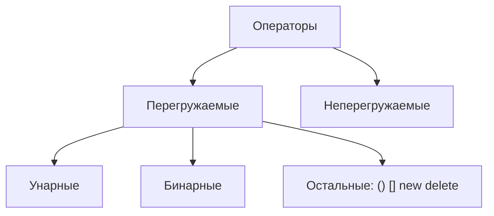

# Перегрузка операторов

> [!abstract] О чём заметка
> Перегрузка операторов (operator overloading) позволяет научить собственные классы работать с привычными знаками `+`, `-`, `==`, `[]`, `++` и другими, так что код пользовательских типов читается так же естественно, как код с `int` и `double`. Разберём синтаксис, различие между перегрузкой внутри и вне класса, бинарные и унарные операторы, префиксный и постфиксный инкремент, операторы приведения типа, `()` и `[]`, а также список того, что перегрузить нельзя.

## Зачем это нужно

Представим класс комплексных чисел `ComplexNumber`. Комплексное число состоит из действительной части (`re`) и мнимой (`im`); при сложении и вычитании действительные и мнимые части обрабатываются по отдельности. Решение «в лоб» — методы `Add` и `Sub`:

```cpp
ComplexNumber sum = c1.Add(c2);
ComplexNumber sub = c1.Sub(c2);
```

Работает, но выглядит громоздко. Для встроенных типов мы пишем `a + b`, и хотелось бы так же писать для своих. C++ это позволяет: можно **перегрузить оператор (operator overloading)** — создать свою версию оператора, которая для данного класса делает то, что нужно нам.

Важные ограничения:

- **Создавать новые операторы нельзя** — только перегружать существующие (нельзя изобрести `**` или `<+>`).
- Нельзя изменить количество операндов, приоритет и ассоциативность оператора.
- Хотя бы один операнд должен быть пользовательского типа: переопределить `1 + 2` для `int` нельзя.

> [!note] Оператор — это синтаксический сахар
> У каждого оператора есть «полная форма» — функция со специальным именем `operator+`, `operator==` и т. д. Запись `a + b` — более короткая форма вызова `a.operator+(b)` (или `operator+(a, b)`). Когда мы перегружаем оператор, мы на самом деле пишем именно такую функцию.

Общий синтаксис:

```text
<возвращаемый тип> operator<символ оператора>([<аргументы>]) { <реализация> }
```

Большинство операторов можно определить **как внутри класса (методом), так и вне его (глобальной функцией)**. Классификация операторов:



## Бинарные операторы

**Бинарные операторы** требуют двух операндов (из двух значений получается третье): сложение, вычитание, сравнение и т. д. Перегружать можно:

| Группа | Операторы |
|---|---|
| Арифметика | `+ - * / %` и составные `+= -= *= /= %=` |
| Побитовые | `& \| ^ << >>` и составные `&= \|= ^= <<= >>=` |
| Сравнение | `< <= > >= == !=` |
| Логические | `&& \|\|` |
| Прочие | `=` (присваивание), `,` (запятая), `->`, `->*` |

### Внутри класса

```text
<возвращаемый тип> operator<символ>(<аргумент>)
```

Внутри класса у бинарного оператора **всего один параметр**, потому что первый (левый) операнд — это сам объект, у которого вызывается оператор (`*this`). Возвращаемый тип ничем не ограничен, но чаще всего это класс или ссылка на класс.

Улучшенный `ComplexNumber` — вместо `Add` и `Sub` перегружаем `+` и `-`:

```cpp
#include <iostream>

class ComplexNumber
{
    double re_, im_;
public:
    ComplexNumber(double re = 0, double im = 0) : re_(re), im_(im) {}

    ComplexNumber operator+(const ComplexNumber& other) const
    { return ComplexNumber(re_ + other.re_, im_ + other.im_); }
    ComplexNumber operator-(const ComplexNumber& other) const
    { return ComplexNumber(re_ - other.re_, im_ - other.im_); }

    void Print() const { std::cout << re_ << (im_ < 0 ? "" : "+") << im_ << "i\n"; }
};

int main()
{
    ComplexNumber c1(1, 1), c2(4, 2);
    (c1 + c2).Print();   // Вывод: 5+3i
    (c1 - c2).Print();   // Вывод: -3-1i
    (c1 + 3).Print();    // Вывод: 4+1i  (3 неявно превращается в ComplexNumber(3, 0))
}
```

Обратите внимание на оформление: параметр принимается по константной ссылке (см. [[05 Функции и рекурсия]] про передачу по ссылке), а методы, не меняющие объект, помечены `const` — иначе их нельзя будет вызвать у временных и константных объектов.

> [!tip] Перегрузка по типу второго операнда
> В исходной лекции для сложения с обычным числом пишут отдельную перегрузку `operator+(int)`, которая меняет только действительную часть. Это допустимо: операторы перегружаются по типам аргументов так же, как обычные функции. В примере выше она не нужна, потому что конструктор `ComplexNumber(double, double = 0)` позволяет неявно преобразовать `3` в комплексное число; отдельная перегрузка нужна, только если поведение должно отличаться.

### Снаружи класса

Если оператор определён вне класса, он — **глобальная функция**, и оба операнда указываются явно:

```text
<возвращаемый тип> operator<символ>(<аргумент 1>, <аргумент 2>)
```

Отличия от варианта «внутри класса»:

1. Нет доступа к `private`/`protected` членам (если не объявить функцию дружественной — `friend`).
2. Можно **поменять операнды местами**, если они разных типов. В методе левый операнд всегда имеет тип класса, поэтому `c + 3` скомпилируется, а `3 + c` — нет.

```cpp
#include <iostream>

class ComplexNumber
{
    double re_, im_;
public:
    ComplexNumber(double re = 0, double im = 0) : re_(re), im_(im) {}
    ComplexNumber operator+(int other) const { return ComplexNumber(re_ + other, im_); }
    void Print() const { std::cout << re_ << (im_ < 0 ? "" : "+") << im_ << "i\n"; }
    friend ComplexNumber operator+(int lhs, const ComplexNumber& rhs);
};

ComplexNumber operator+(int lhs, const ComplexNumber& rhs)
{
    return ComplexNumber(lhs + rhs.re_, rhs.im_);
}

int main()
{
    ComplexNumber c(1, 1);
    (c + 3).Print();   // Вывод: 4+1i
    (3 + c).Print();   // Вывод: 4+1i
}
```

> [!tip] Что выбрать
> Операторы, которые меняют левый операнд (`=`, `+=`, `++`), пишите методами. Симметричные операторы (`+`, `==`, `<`) и операторы потокового ввода-вывода `<<`/`>>` (левый операнд — `std::ostream`, не наш класс) — удобнее внешними функциями.

### Операторы сравнения

Для комплексных чисел нет естественного порядка, поэтому условимся сравнивать их **по модулю**: $|z| = \sqrt{re^2 + im^2}$. Всего шесть операторов (`>`, `>=`, `<`, `<=`, `==`, `!=`), но уникальный код нужен лишь в **двух**: в одном из `==`/`!=` и в одном из `<`, `<=`, `>`, `>=`. Остальные выражаются через них:

- `!=` — это отрицание `==`;
- `<` — это `>` с переставленными аргументами;
- `>=` — отрицание `<`, а `<=` — отрицание `>`.

```cpp
#include <cmath>
#include <iostream>

class ComplexNumber
{
    double re_, im_;
public:
    ComplexNumber(double re = 0, double im = 0) : re_(re), im_(im) {}

    double Abs() const { return std::sqrt(re_ * re_ + im_ * im_); }

    bool operator==(const ComplexNumber& other) const { return Abs() == other.Abs(); }
    bool operator!=(const ComplexNumber& other) const { return !(*this == other); }
    bool operator>(const ComplexNumber& other) const { return Abs() > other.Abs(); }
    bool operator<(const ComplexNumber& other) const { return other > *this; }
    bool operator>=(const ComplexNumber& other) const { return !(*this < other); }
    bool operator<=(const ComplexNumber& other) const { return !(*this > other); }
};

int main()
{
    ComplexNumber c1(1, 1), c2(4, 2);
    std::cout << (c1 < c2) << (c1 <= c2) << (c1 > c2)
              << (c1 >= c2) << (c1 == c2) << (c1 != c2) << std::endl;
    // Вывод: 110001   (|c1| ≈ 1.41 < |c2| ≈ 4.47)
}
```

> [!warning] Сравнение вещественных чисел
> `==` для `double` в примере показан ради простоты. В реальном коде вещественные числа сравнивают с допуском (`std::abs(a - b) < eps`). Кроме того, у такой семантики есть побочный эффект: разные числа `1+1i` и `1-1i` окажутся «равными», раз модули совпадают. Для настоящего равенства комплексных чисел сравнивают обе части.

### Оператор присваивания `=`

Оператор присваивания (assignment operator) — особый случай:

- он может быть **только методом класса**, глобальной функцией быть не может;
- **не наследуется**;
- если вы его не написали, **компилятор генерирует его сам** (как конструктор по умолчанию) — побайтовое копирование полей;
- чтобы работали цепочки `a = b = c`, он должен **возвращать ссылку на самого себя** (`*this`).

```cpp
#include <iostream>

class ComplexNumber
{
    double re_, im_;
public:
    ComplexNumber(double re = 0, double im = 0) : re_(re), im_(im) {}
    ComplexNumber& operator=(const ComplexNumber& other)
    {
        re_ = other.re_;
        im_ = other.im_;
        return *this;
    }
    void Print() const { std::cout << re_ << (im_ < 0 ? "" : "+") << im_ << "i\n"; }
};

int main()
{
    ComplexNumber c1(1, 1), c2(4, 2), c3(5, 6);
    c1 = c3 = c2;      // c3 = c2 возвращает ссылку на c3, и уже её получает c1
    c1.Print();        // Вывод: 4+2i
    c3.Print();        // Вывод: 4+2i
}
```

Для класса из двух чисел писать оператор вручную не нужно — версия по умолчанию сделает то же самое. Собственный оператор нужен, когда класс владеет ресурсом (например, динамической памятью, см. [[08 Указатели и динамическая память]]); подробнее — в [[02 Жизненный цикл объекта и RAII]].

### Оператор доступа к члену `->`

Самый хитрый из бинарных операторов. Его особенности:

- обязан быть **методом класса**;
- хотя он «бинарный», **аргументов у него нет** (правый операнд — имя члена — не значение, а идентификатор);
- результат оператора используется для поиска члена, указанного после `->`. Если результат — **не указатель**, у него снова вызывается `operator->`, и так до тех пор, пока не получится указатель — по нему уже ищется член.

```cpp
#include <iostream>

struct RealStruct { int a; };

struct Wrapper1Struct
{
    RealStruct* wrappee;
    RealStruct* operator->() { return wrappee; }
};

struct Wrapper2Struct
{
    Wrapper1Struct* wrappee;
    Wrapper1Struct& operator->() { return *wrappee; }
};

int main()
{
    RealStruct rs = { 5 };
    Wrapper1Struct w1 = { &rs };
    Wrapper2Struct w2 = { &w1 };
    std::cout << rs.a << " " << w1->a << " " << w2->a << std::endl;   // Вывод: 5 5 5
}
```

Для `w2->a` оператор `w2.operator->()` вернул `Wrapper1Struct&` (не указатель), поэтому цепочка продолжилась: `w1.operator->()` вернул `RealStruct*`, и по нему найден член `a`. Так устроены классы-обёртки и умные указатели (см. [[03 Умные указатели]]). Оператор `->*` работает похоже, но подробности требуют знаний об указателях на члены класса.

## Унарные операторы

**Унарные операторы** имеют один операнд. Перегружаются:

| Оператор | Смысл |
|---|---|
| `!` | логическое НЕ |
| `&` | взятие адреса |
| `~` | битовое дополнение |
| `*` | разыменование |
| `+`, `-` | унарные плюс и минус |
| `++`, `--` | инкремент и декремент (префиксный и постфиксный) |
| `operator <тип>` | операторы приведения типа |

Синтаксис внутри класса — **без аргументов**, снаружи — **с одним**:

```text
<тип> operator<символ>()            // внутри класса
<тип> operator<символ>(<аргумент>)  // снаружи
```

Операторы `&` и `*` перегружают редко — в основном в **классах-обёртках** (wrapper, прокси, proxy): когда вы работаете с прокси, на самом деле вы хотите работать с тем, что он оборачивает. Тогда `&` возвращает адрес обёрнутого значения, а `*` разыменовывает прокси в это значение (как у `->`).

### Префиксный и постфиксный инкремент

У `++` и `--` две формы — `++a` и `a++`. Чтобы их различить, постфиксной форме добавлен **фиктивный параметр `int`**, который в теле не используется:

| Форма | Внутри класса | Снаружи класса |
|---|---|---|
| префиксная `++a` | `T& operator++();` | `T& operator++(T&);` |
| постфиксная `a++` | `T operator++(int);` | `T operator++(T&, int);` |

Префиксная версия меняет объект и возвращает **ссылку** на него. Постфиксная должна вернуть **старое значение**, поэтому сохраняет копию, вызывает префиксную версию и возвращает копию (по значению).

```cpp
#include <iostream>

class ComplexNumber
{
    double re_, im_;
public:
    ComplexNumber(double re = 0, double im = 0) : re_(re), im_(im) {}
    ComplexNumber operator+(const ComplexNumber& o) const
    { return ComplexNumber(re_ + o.re_, im_ + o.im_); }

    ComplexNumber& operator++() { ++re_; ++im_; return *this; }   // ++a
    ComplexNumber operator++(int)                                  // a++
    {
        ComplexNumber temp = *this;   // запомнили старое значение
        ++(*this);                    // изменили объект
        return temp;                  // вернули старое
    }
    void Print() const { std::cout << re_ << (im_ < 0 ? "" : "+") << im_ << "i\n"; }
};

int main()
{
    ComplexNumber c1(1, 1), c2(4, 2), c3(1, 1);
    ComplexNumber sum_pre = ++c1 + c2;    // сначала c1 -> 2+2i, потом сложение
    ComplexNumber sum_post = c3++ + c2;   // сложение со старым c3, потом c3 -> 2+2i
    sum_pre.Print();    // Вывод: 6+4i
    sum_post.Print();   // Вывод: 5+3i
    c1.Print();         // Вывод: 2+2i
    c3.Print();         // Вывод: 2+2i
}
```

> [!tip] Префиксная форма дешевле
> Постфиксная версия создаёт копию объекта. Для пользовательских типов (например, итераторов, см. [[06 STL часть 1]]) предпочитайте `++i` вместо `i++`, если старое значение не нужно.

### Операторы приведения типа

**Оператор приведения типа (conversion operator)** позволяет преобразовывать объект класса в другой тип. Приведение значений *другого* типа к нашему классу делают конструкторы; приведение *нашего* класса к другому типу — именно эти операторы.

```text
[explicit] operator <тип>()
```

- `<тип>` одновременно задаёт тип, к которому приводим, и тип результата (возвращаемый тип в записи **не указывается**);
- аргументов нет;
- по умолчанию оператор **неявный (implicit)**: вызывается автоматически, например при передаче объекта в функцию, ожидающую другой тип;
- с ключевым словом **`explicit`** оператор срабатывает только при явном приведении (`static_cast<double>(c)` или `(double)c`);
- оператор приведения может быть виртуальным (см. [[05 Наследование и полиморфизм]]).

```cpp
#include <cmath>
#include <iostream>

class ComplexNumber
{
    double re_, im_;
public:
    ComplexNumber(double re = 0, double im = 0) : re_(re), im_(im) {}
    double Abs() const { return std::sqrt(re_ * re_ + im_ * im_); }

    operator double() const { return Abs(); }    // неявное приведение к double
};

int main()
{
    ComplexNumber c1(1, 1);
    double c1_abs = c1;                // неявный вызов operator double
    std::cout << c1_abs << std::endl;  // Вывод: 1.41421
}
```

> [!warning] Неявные преобразования коварны
> Неявный `operator double` позволит случайно написать `c1 + 2.5` (получится число, а не комплексное число) или сравнить комплексное с `double`. Если нет веской причины, делайте операторы приведения `explicit`. Исключение — `explicit operator bool`, который при этом всё равно работает в условиях `if`.

## Остальные операторы

Четыре перегружаемых оператора не относятся ни к унарным, ни к бинарным:

| Оператор | Назначение | Требования |
|---|---|---|
| `( )` | вызов функции | только метод; любое число аргументов |
| `[ ]` | доступ по индексу | только метод; ровно один аргумент любого типа |
| `new` | создание объекта в куче | перегружают очень редко |
| `delete` | освобождение памяти | перегружают очень редко |

**Оператор `()`** позволяет вызывать объект как функцию (такие объекты называют функторами, см. [[05 Шаблоны и функторы]]). Он похож на оператор приведения, но у него есть возвращаемый тип и аргументы.

**Оператор `[]`** превращает объект в «массив», в том числе ассоциативный (индекс может быть, например, строкой). Именно так работают контейнеры стандартной библиотеки вроде `std::vector`.

Пример, объединяющий оба оператора — многочлен, который можно вычислять как функцию и читать/менять коэффициенты по индексу:

```cpp
#include <iostream>
#include <vector>

class Polynomial
{
    std::vector<double> coef_;   // coef_[i] — коэффициент при x^i
public:
    Polynomial(std::vector<double> c) : coef_(std::move(c)) {}

    double operator()(double x) const          // p(x)
    {
        double result = 0;
        for (std::size_t i = coef_.size(); i-- > 0;)
            result = result * x + coef_[i];    // схема Горнера
        return result;
    }
    double& operator[](std::size_t i) { return coef_.at(i); }
    const double& operator[](std::size_t i) const { return coef_.at(i); }
};

int main()
{
    Polynomial p({1, 0, 2});          // 1 + 2x^2
    std::cout << p(3) << std::endl;   // Вывод: 19
    p[1] = 5;                         // 1 + 5x + 2x^2
    std::cout << p(1) << std::endl;   // Вывод: 8
}
```

Обратите внимание: `operator[]` возвращает **ссылку**, поэтому `p[1] = 5` изменяет коэффициент, и есть две версии — для обычного и для `const`-объекта.

## Вывод в поток: перегрузка `<<`

Самая частая перегрузка на практике — вывод объекта через `std::cout`. Левый операнд — `std::ostream`, поэтому оператор определяют **вне класса**, а возвращают ссылку на поток для цепочек `cout << a << b`:

```cpp
#include <iostream>

class ComplexNumber
{
    double re_, im_;
public:
    ComplexNumber(double re = 0, double im = 0) : re_(re), im_(im) {}
    friend std::ostream& operator<<(std::ostream& os, const ComplexNumber& c);
};

std::ostream& operator<<(std::ostream& os, const ComplexNumber& c)
{
    return os << c.re_ << (c.im_ < 0 ? "" : "+") << c.im_ << "i";
}

int main()
{
    ComplexNumber a(1, 2), b(3, -4);
    std::cout << a << " и " << b << std::endl;   // Вывод: 1+2i и 3-4i
}
```

## Неперегружаемые операторы

Эти операторы перегрузить нельзя:

| Оператор | Назначение |
|---|---|
| `.` | выбор члена |
| `.*` | выбор члена по указателю на него |
| `::` | разрешение области видимости |
| `?:` | тернарный условный оператор |
| `#` | препроцессорное преобразование в строку |
| `##` | препроцессорная конкатенация |

Последние два относятся к препроцессору (см. [[07 Препроцессор и макросы]]) и вообще не являются операторами языка в обычном смысле. Также нельзя перегрузить `sizeof`, `typeid` и операторы приведения `static_cast`/`dynamic_cast` и т. п.

## Частые ошибки

> [!warning] Типичные промахи
> - **Бессмысленная перегрузка.** Оператор должен делать то, чего от него ждут. `operator+`, который что-то печатает или удаляет, — плохой стиль. Если смысл неочевиден, лучше обычный метод с понятным именем.
> - **Забыли `const`.** Метод `bool operator==(ComplexNumber other)` без `const` нельзя вызвать у константного объекта.
> - **Передача по значению** там, где нужна `const T&` — лишние копии.
> - **Оператор `=` вернул не ссылку** — ломаются цепочки присваиваний; забыли `return *this`.
> - **Перегрузка `&&` и `||`.** Перегруженные версии теряют «ленивое» вычисление: оба операнда вычисляются всегда. Лучше не перегружать.
> - **Непоследовательный набор.** Если перегрузили `==`, перегрузите и `!=`; если `<` — то и остальные сравнения. Иначе поведение будет неожиданным.
> - **Неявный `operator double`** приводит к незаметным преобразованиям — делайте `explicit`.

## Кратко (шпаргалка)

- Перегружать можно только существующие операторы; хотя бы один операнд — пользовательского типа.
- Синтаксис: `<тип> operator<символ>(<аргументы>)`.
- Метод класса: бинарный — 1 параметр (левый операнд — `*this`); унарный — 0. Глобальная функция: бинарный — 2, унарный — 1; доступ только к `public` (или через `friend`).
- Только методами: `=`, `->`, `()`, `[]` (и операторы приведения).
- Сравнения: уникальный код — в `==` и в `<` (или `>`); остальное выражается через них.
- `operator=` возвращает `T&` (`*this`); компилятор генерирует его сам, если не написан; не наследуется.
- `++a` — `T& operator++()`; `a++` — `T operator++(int)` (возвращает копию старого значения).
- Приведение типа: `[explicit] operator <тип>()` — без возвращаемого типа и аргументов.
- Нельзя перегрузить: `.`, `.*`, `::`, `?:`, `#`, `##`.

## Связанные темы

- [[02 Классы и объекты]] — перегрузка операторов описывается внутри классов; там же конструкторы и `this`.
- [[03 Абстракция и инкапсуляция]] — доступ к `private` членам и дружественные функции.
- [[05 Шаблоны и функторы]] — оператор `()` лежит в основе функторов.
- [[06 STL часть 1]] — контейнеры и итераторы используют `[]`, `++`, `*`, `->`.
- [[03 Умные указатели]] — классы-обёртки с перегруженными `*` и `->`.
- [[05 Наследование и полиморфизм]] — как ведут себя операторы при наследовании.
