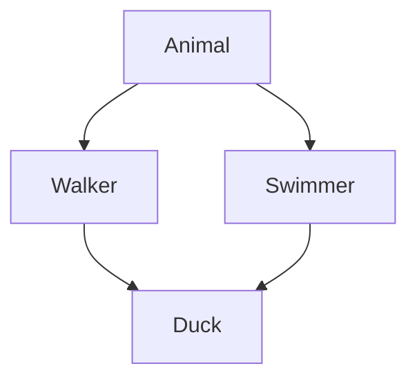

# Наследование и полиморфизм

> [!abstract] О чём заметка
> Наследование (inheritance) позволяет создавать новый класс на основе существующего, не переписывая уже готовые поля и методы. Полиморфизм (polymorphism) позволяет работать с объектами разных производных классов через единый интерфейс базового класса. Разберём синтаксис наследования, права доступа, порядок вызова конструкторов, множественное наследование, приведение к базовому типу, виртуальные методы и `override`.

## Наследование

Наследование — это скорее **механизм**, чем принцип ООП, и один из самых важных и часто используемых. Относится оно к классам (и к структурам: всё, что сказано про классы, верно и для структур, см. [[01 Структуры и перечисления]]).

Один класс может **наследовать** другой. Тогда у нас есть:

- **класс-родитель** (суперкласс, базовый класс, parent, base class);
- **класс-потомок** (наследник, подкласс, производный класс, child, derived class).

Потомок получает **все поля и методы родителя** без дополнительных усилий и может добавлять свои. Наследование выражает отношение «является»: `Circle` *является* `Shape`, `Student` *является* `Person`. Если отношения «является» нет (например, «автомобиль содержит двигатель»), используют не наследование, а поле-объект (композицию).

### Синтаксис

После имени потомка ставят двоеточие, затем модификатор доступа и имя родителя:

```cpp
class Parent { /* ... */ };
class Child : public Parent { /* ... */ };
```

```cpp
#include <iostream>

class Parent
{
public:
    int field1 = 0;
    void method1() { std::cout << "method1, field1 = " << field1 << "\n"; }
};

class Child : public Parent
{
public:
    void method2()
    {
        field1 = 30;     // унаследованное поле доступно внутри потомка
        method1();       // и унаследованный метод тоже
    }
};

int main()
{
    Child child;
    child.field1 = 20;   // поле родителя доступно у объекта потомка
    child.method1();     // Вывод: method1, field1 = 20
    child.method2();     // Вывод: method1, field1 = 30
}
```

### Модификаторы доступа и наследование

Вспомним три уровня доступа из [[03 Абстракция и инкапсуляция]]: `public` — виден всем, `private` — виден только самому классу, **`protected`** — виден **самому классу и его наследникам**, но не внешнему коду.

```cpp
#include <iostream>

class Parent
{
public:
    void public_method() { std::cout << "public\n"; }
protected:
    void protected_method() { std::cout << "protected\n"; }
private:
    void private_method() { std::cout << "private\n"; }
public:
    void method1()          // сам родитель видит все свои члены
    {
        public_method();
        protected_method();
        private_method();
    }
};

class Child : public Parent
{
public:
    void method2()
    {
        public_method();       // можно
        protected_method();    // можно
        // private_method();   // ошибка: private родителя недоступен наследнику
    }
};

int main()
{
    Child child;
    child.public_method();        // можно
    // child.protected_method();  // ошибка: protected снаружи недоступен
    child.method2();
}
```

Но кроме модификаторов внутри класса есть ещё **модификатор перед именем родителя** — он управляет тем, как меняется видимость унаследованных членов для всех, кто работает с потомком:

| Наследование | `public` члены родителя становятся | `protected` члены становятся | `private` члены |
|---|---|---|---|
| `public` | `public` | `protected` | недоступны |
| `protected` | `protected` | `protected` | недоступны |
| `private` | `private` | `private` | недоступны |

То есть модификатор наследования может только **ужесточить** доступ. **Если модификатор не указан, по умолчанию он `private`** (для `struct` — `public`).

Что это значит на практике, видно по цепочке `Parent → Child → GrandChild`:

| Как `Child` наследует `Parent` | `Child` изнутри видит | Внешний код видит у `Child` | `GrandChild : public Child` изнутри видит |
|---|---|---|---|
| `public` | `public`, `protected` | `public` члены | `public`, `protected` |
| `protected` | `public`, `protected` | ничего | `public`, `protected` |
| `private` | `public`, `protected` | ничего | **ничего** |

`private`-члены родителя **не видны никому, кроме самого родителя**, при любом виде наследования — они в объекте есть, но обратиться к ним из потомка нельзя.

> [!note] Что используют на практике
> Почти всегда — `public`-наследование: оно и выражает «является». `protected` и `private` наследование означают «реализован через» и встречаются редко; в остальных случаях лучше композиция.

> [!example] Проверьте себя
> Что будет, если `Child : protected Parent`, а `GrandChild : public Child` вызывает `public_method()` и `protected_method()` в своём методе, а `main` вызывает `child.public_method()`?
> Внутри `GrandChild` оба вызова допустимы (в `Child` они стали `protected`, а потомок видит `protected`). В `main` вызов `child.public_method()` — ошибка: для внешнего кода `public_method` теперь `protected`.

## Конструкторы и наследование

В отличие от полей и методов, **конструкторы не наследуются автоматически**. Но при создании объекта потомка вызываются конструкторы **и потомка, и родителя**, причём в строго определённом порядке: **сначала конструктор родителя, потом конструктор потомка** (родитель должен быть построен раньше, чтобы потомок мог на него опираться).

```cpp
#include <iostream>

class Parent
{
public:
    Parent() { std::cout << "Создаю родителя\n"; }
};

class Child : public Parent
{
public:
    Child() { std::cout << "Создаю потомка\n"; }
};

int main()
{
    Parent parent;   // Вывод: Создаю родителя
    Child child;     // Вывод: Создаю родителя
                     //        Создаю потомка
}
```

### Если у родителя нет конструктора без параметров

По умолчанию конструктор потомка вызывает **конструктор родителя без параметров**. Если родитель его не имеет (например, объявлен только `Parent(int a)`), код **не скомпилируется**:

```cpp
class Parent { public: Parent(int a) {} };
class Child : public Parent { public: Child() {} };   // ошибка: нет Parent()
```

### Выбор конструктора родителя

Нужный конструктор родителя указывают **в списке инициализации** конструктора потомка — после двоеточия:

```cpp
class Child : public Parent
{
public:
    Child() : Parent(5) { ... }          // фиксированное значение
    Child(int a) : Parent(a) { ... }     // значение передано из потомка
};
```

Пустые скобки (`Parent()`) — вызов конструктора без параметров, что и происходит по умолчанию.

### Делегирование: вызов собственного конструктора

Вместо имени родителя в списке инициализации можно указать **имя своего же класса** — тогда конструктор сначала вызовет другой конструктор этого класса (делегирующий конструктор, delegating constructor), а затем выполнит своё тело:

```cpp
#include <iostream>

class Parent
{
public:
    Parent(int a) { std::cout << "Создаю родителя " << a << "\n"; }
};

class Child : public Parent
{
public:
    Child() : Child(5) { std::cout << "Создаю потомка\n"; }
    Child(int a) : Parent(a) { std::cout << "Создаю потомка " << a << "\n"; }
};

int main()
{
    Parent parent(3);   // Вывод: Создаю родителя 3
    Child child_empty;  // Вывод: Создаю родителя 5
                        //        Создаю потомка 5
                        //        Создаю потомка
    Child child_8(8);   // Вывод: Создаю родителя 8
                        //        Создаю потомка 8
}
```

Порядок для `child_empty`: `Child()` делегирует `Child(5)`, тот вызывает `Parent(5)`; затем исполняются тело `Child(int)`, и только после него — тело `Child()`.

### Деструкторы: обратный порядок

Деструкторы вызываются в **обратном порядке**: сначала потомка, потом родителя. Для полиморфных классов (с виртуальными методами) деструктор базового класса должен быть **виртуальным**, иначе при удалении объекта через указатель на базовый класс не вызовется деструктор потомка и случится утечка (подробнее про жизненный цикл объекта — в [[02 Жизненный цикл объекта и RAII]]):

```cpp
#include <iostream>

class Parent
{
public:
    Parent()          { std::cout << "Parent()\n"; }
    virtual ~Parent() { std::cout << "~Parent()\n"; }
};

class Child : public Parent
{
public:
    Child()           { std::cout << "Child()\n"; }
    ~Child() override { std::cout << "~Child()\n"; }
};

int main()
{
    Parent* p = new Child;
    delete p;
    // Вывод: Parent()
    //        Child()
    //        ~Child()
    //        ~Parent()
}
```

## Множественное наследование

В C++ у класса может быть **несколько родителей** (multiple inheritance). Потомок получает поля и методы всех:

```cpp
class Child : [<модиф.>] Parent1, [<модиф.>] Parent2, ..., [<модиф.>] ParentN { ... };
```

```cpp
class Parent1 { public: void method1() {} };
class Parent2 { public: void method2() {} };
class Parent3 { public: void method3() {} };

class Child : public Parent1, public Parent2, public Parent3 {};

int main()
{
    Child child;
    child.method1();   // правильно
    child.method2();   // правильно
    child.method3();   // правильно
}
```

Конструкторы родителей вызываются в порядке, в котором они перечислены в объявлении класса.

### Проблемы

1. **Конфликт имён.** Если в двух родителях есть метод с одинаковой сигнатурой, непонятно, какой вызывать в потомке. Компилятор сообщит о неоднозначности; разрешить её можно явным указанием класса: `ab.A::hello()`.
2. **Ромбовидное наследование (diamond problem).** Потомок наследует двух родителей, а те — одного и того же «деда». Тогда в объекте оказывается **два подобъекта деда**, возникают неоднозначности и расход памяти.



```cpp
#include <iostream>

class A { public: void hello() { std::cout << "A\n"; } };
class B { public: void hello() { std::cout << "B\n"; } };
class AB : public A, public B {};

int main()
{
    AB ab;
    ab.A::hello();   // Вывод: A
    ab.B::hello();   // Вывод: B
    // ab.hello();   // ошибка: неоднозначность
}
```

Для ромба в C++ есть **виртуальное наследование** (`class Walker : public virtual Animal`) — тогда общий дед хранится в одном экземпляре:

```cpp
#include <iostream>

class Animal  { public: int legs = 4; void eat() { std::cout << "ем\n"; } };
class Walker  : public virtual Animal {};
class Swimmer : public virtual Animal {};
class Duck    : public Walker, public Swimmer {};

int main()
{
    Duck d;
    d.eat();                     // Вывод: ем   (без неоднозначности)
    std::cout << d.legs << "\n"; // Вывод: 4
}
```

Из-за этих сложностей множественное наследование **используется редко**, а во многих ООП-языках вообще запрещено (там вместо него — интерфейсы). Безопасный и частый случай — наследование от одного «настоящего» класса и нескольких чисто абстрактных интерфейсов (см. ниже).

## Полиморфизм

> [!note] Определение
> **Полиморфизм** — способность, имея указатель (или ссылку) на объект родительского класса, **вызывать методы его потомков**: реальная версия метода выбирается по фактическому типу объекта во время выполнения программы.

Чтобы это понять, нужно сначала разобраться с приведением к базовому типу.

### Приведение к базовому типу

Мы можем неявно привести `float` к `double`. С классами похоже: **указателю на родителя можно присвоить адрес потомка** (приведение «вверх», upcasting). Это безопасно: потомок «является» родителем. Но через такой указатель видны **только члены, объявленные в родителе**.

```cpp
#include <iostream>

class Parent
{
public:
    int p_field;
    Parent() { p_field = 1; }
};

class Child : public Parent
{
public:
    int c_field;
    Child() { p_field = 2; c_field = 3; }
};

int main()
{
    Parent parent;
    std::cout << parent.p_field << std::endl;       // Вывод: 1
    // std::cout << parent.c_field;                 // ошибка: у Parent нет c_field
    Child child;
    std::cout << child.p_field << std::endl;        // Вывод: 2
    std::cout << child.c_field << std::endl;        // Вывод: 3
    Parent* par_child = &child;                     // приведение к базовому типу
    std::cout << par_child->p_field << std::endl;   // Вывод: 2
    // std::cout << par_child->c_field;             // ошибка: через Parent* виден только Parent
}
```

Поле `p_field` — по-прежнему поле объекта `child` (поэтому 2, а не 1), но тип указателя ограничивает набор доступных имён.

> [!warning] Срезка (slicing)
> Всё это работает для **указателей и ссылок**. Если присвоить объект потомка **переменной-значению** типа родителя (`Parent p = child;`) или передать в функцию по значению, произойдёт копирование только «родительской части» — всё, что добавил потомок, и его переопределения «срезаются». Для полиморфизма всегда используйте указатели или ссылки.

### Одинаковые методы в родителе и потомке

Что произойдёт, если в потомке есть метод с той же сигнатурой, что в родителе? Если метод **не виртуальный**, вызов определяется **типом указателя**, а не реальным объектом:

```cpp
#include <iostream>

class Parent { public: void method() { std::cout << "Родитель\n"; } };
class Child : public Parent { public: void method() { std::cout << "Потомок\n"; } };

int main()
{
    Parent parent;
    parent.method();        // Вывод: Родитель
    Child child;
    child.method();         // Вывод: Потомок
    Parent* par_child = &child;
    par_child->method();    // Вывод: Родитель  <- не то, что мы хотели
}
```

Потомок здесь не «переопределил», а **скрыл** (hide) метод родителя.

### Виртуальные методы и override

**Виртуальный метод (virtual method)** — метод, помеченный ключевым словом `virtual` (перед возвращаемым типом). Его можно **переопределить (override)** в потомке: тогда вызов через указатель на родителя выполнит версию того класса, чей объект реально находится в памяти. Этот механизм называют **динамическим (поздним) связыванием**: выбор реализации происходит во время работы программы по скрытой таблице виртуальных функций у объекта.

Переопределяющий метод обычно помечают **`override`** — после сигнатуры, перед телом. Необязательно, но ключевое слово заставляет компилятор проверить, что вы действительно переопределяете виртуальный метод, иначе будет ошибка компиляции — это защищает от опечаток в сигнатуре (например, забыли `const`).

```cpp
#include <iostream>

class Parent
{
public:
    virtual void method() { std::cout << "Родитель\n"; }
    virtual ~Parent() = default;
};

class Child : public Parent
{
public:
    void method() override { std::cout << "Потомок\n"; }
};

int main()
{
    Parent parent;
    parent.method();        // Вывод: Родитель
    Child child;
    child.method();         // Вывод: Потомок
    Parent* par_child = &child;
    par_child->method();    // Вывод: Потомок  <- работает полиморфизм
}
```

Переопределённый метод может вызвать **базовую реализацию** — по аналогии с вызовом конструктора предка, через `Родитель::метод()`:

```cpp
class Child : public Parent
{
public:
    void method() override
    {
        std::cout << "Потомок\n";
        Parent::method();            // затем выполнится версия родителя
    }
};
// child.method() и par_child->method() печатают: Потомок, Родитель
```

### Абстрактные классы

Метод можно объявить **чисто виртуальным (pure virtual)**: `virtual double Area() const = 0;`. У него нет реализации в базовом классе. Класс с хотя бы одним чисто виртуальным методом называют **абстрактным** — создать его объект нельзя, он служит только интерфейсом для потомков, а потомок обязан переопределить все такие методы.

### Полиморфные функции

С помощью наследования и виртуальных методов пишут **полиморфные функции** — те, у которых аргумент является указателем (или ссылкой) на базовый класс. Такую функцию достаточно написать **один раз**; потом можно создавать новые классы-наследники, переопределять в них методы и передавать их в старую функцию — она будет работать с ними, не зная об их существовании.

```cpp
#include <iostream>
#include <memory>
#include <string>
#include <vector>

class Shape
{
public:
    virtual ~Shape() = default;
    virtual double Area() const = 0;               // чисто виртуальный метод
    virtual std::string Name() const { return "фигура"; }
};

class Circle : public Shape
{
    double r_;
public:
    explicit Circle(double r) : r_(r) {}
    double Area() const override { return 3.14159265 * r_ * r_; }
    std::string Name() const override { return "круг"; }
};

class Rectangle : public Shape
{
    double w_, h_;
public:
    Rectangle(double w, double h) : w_(w), h_(h) {}
    double Area() const override { return w_ * h_; }
    std::string Name() const override { return "прямоугольник"; }
};

// Полиморфная функция: ничего не знает о конкретных наследниках
void PrintInfo(const Shape& shape)
{
    std::cout << shape.Name() << ": " << shape.Area() << "\n";
}

int main()
{
    Circle c(1);
    Rectangle r(2, 3);
    PrintInfo(c);   // Вывод: круг: 3.14159
    PrintInfo(r);   // Вывод: прямоугольник: 6

    std::vector<std::unique_ptr<Shape>> shapes;       // однородный список разных фигур
    shapes.push_back(std::make_unique<Circle>(2));
    shapes.push_back(std::make_unique<Rectangle>(1, 4));
    double total = 0;
    for (const auto& s : shapes) total += s->Area();
    std::cout << "Сумма площадей: " << total << "\n";   // Вывод: Сумма площадей: 16.5664
}
```

Добавив класс `Triangle : public Shape`, мы не изменим ни `PrintInfo`, ни цикл суммирования. Умные указатели `unique_ptr` разобраны в [[03 Умные указатели]].

## Частые ошибки

> [!warning] Типичные промахи
> - **Нет конструктора по умолчанию у родителя** и не указан вызов нужного конструктора в списке инициализации — ошибка компиляции.
> - **Забыли `virtual`** у метода родителя: вызов через `Parent*` исполняет версию родителя. Тот же результат даёт отличие в сигнатуре (например, `const`) — поэтому всегда пишите `override`.
> - **Невиртуальный деструктор** в базовом классе полиморфной иерархии: `delete` через указатель на базу — неопределённое поведение, деструктор потомка не вызывается.
> - **Срезка**: передача объекта потомка в функцию по значению как базового типа.
> - **Обращение к `private`-члену родителя** из потомка — ошибка; используйте `protected` или публичные методы.
> - **Наследование ради повторного использования кода**, когда нет отношения «является». Часто лучше композиция.
> - **Ромбовидное наследование** без `virtual` — неоднозначности и двойные подобъекты.

## Кратко (шпаргалка)

- Синтаксис: `class Child : public Parent { ... };`. Потомок получает все поля и методы родителя; `private` родителя ему недоступны, `protected` — доступны.
- Модификатор перед родителем только ужесточает доступ; по умолчанию `private` (у `struct` — `public`). На практике — `public`.
- Конструкторы не наследуются; порядок создания: родитель → потомок; уничтожения: потомок → родитель.
- Выбрать конструктор родителя: `Child(...) : Parent(...) { }`; делегировать: `Child() : Child(5) { }`.
- Множественное наследование: `class C : public A, public B`; проблемы — конфликты имён и ромб (лечится `virtual`-наследованием).
- Указатель на родителя может хранить адрес потомка, но видны только члены родителя.
- `virtual` + `override` = полиморфизм: версия метода выбирается по реальному типу объекта; базовую реализацию вызывают `Parent::method()`.
- Базовому классу полиморфной иерархии — виртуальный деструктор.
- Чисто виртуальный метод (`= 0`) делает класс абстрактным.

## Связанные темы

- [[02 Классы и объекты]] — конструкторы, `this`, модификаторы доступа.
- [[03 Абстракция и инкапсуляция]] — принципы, на которых строится наследование; `protected`.
- [[04 Перегрузка операторов]] — оператор присваивания не наследуется; операторы приведения могут быть виртуальными.
- [[02 Жизненный цикл объекта и RAII]] — порядок конструкторов и деструкторов, виртуальный деструктор.
- [[03 Умные указатели]] — хранение полиморфных объектов через `unique_ptr`/`shared_ptr`.
- [[06 Исключения и обработка ошибок]] — иерархия классов исключений строится на наследовании от `std::exception`.
