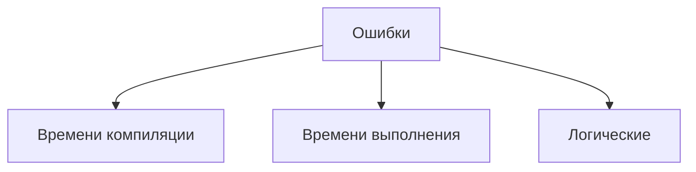
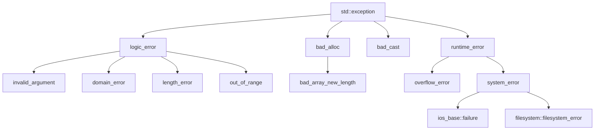

# Исключения и обработка ошибок

> [!abstract] О чём заметка
> Ошибки неизбежны, и важно уметь их находить, предотвращать и корректно обрабатывать. Заметка рассказывает, какие бывают ошибки, как их искать (отладка и логирование), и разбирает два способа сообщить об ошибке из функции: коды возврата и исключения (`throw`, `try`, `catch`, иерархия `std::exception`).

## Какие бывают ошибки



- **Ошибки времени компиляции (compile-time errors)** — синтаксические: забыли `;`, опечатались в имени. Программа не соберётся, а компилятор укажет место и причину. Их легко найти.
- **Ошибки времени выполнения (runtime errors)** — возникают во время работы: деление на ноль, выход за границы массива, открытие несуществующего файла, запрос больше памяти, чем доступно. Программа сама аварийно завершается, потому что не может продолжать.
- **Логические ошибки** — программа работает, но не так, как задумано: вместо умножения чисел в «калькуляторе» они складываются. Программа не падает, просто результат неверный. Такие ошибки сложнее всего поймать; для этого существует тестирование (см. [[08 Тестирование и Unit-тесты]]). В этой заметке они не рассматриваются.

## Как искать ошибку времени выполнения

Допустим, «Калькулятор» в какой-то момент прекращает работу. Чтобы понять причину, нужно проследить ход выполнения кода. Два основных способа:

- **Отладка (debugging)** — запуск в режиме отладчика и пошаговое выполнение программы.
- **Логирование (logging)** — программа сама сообщает, на каком этапе она находится (пишет сообщения в консоль или файл).

| | Отладка | Логирование |
|---|---|---|
| Плюсы | не нужно менять исходный код; наглядно — можно посмотреть значение любой переменной | не требует доступа к исходникам, работает вместе с программой; все этапы выполнения доступны сразу, их нужно только проанализировать |
| Минусы | нужен доступ к коду, отладчик и возможность его запустить; в большой программе поиск может затянуться | нужен дополнительный код в программе; на небольшом коде логирование может занять больше времени, чем вся отладка |

Идеального способа нет. **Отладка** подходит для небольших программ или поиска ошибки в маленьком участке большой программы; **логирование** — для больших и сложных программ.

## Что делать с найденной ошибкой

Предположим, выяснилось, что «Калькулятор» падает при передаче нуля вторым аргументом в `divide`:

```cpp
float divide(float dividend, float divisor)
{
    return dividend / divisor;   // при divisor == 0 — ошибка
}
```

Очевидно, нужно проверять `divisor` до деления. Где это делать — в `main` перед вызовом или внутри `divide`? **Внутри `divide`**: именно функция знает, какие ограничения накладываются на её аргументы. Если проверять в `main` все аргументы всех вызываемых функций, `main` станет огромным и расплывчатым — это нарушение принципа инкапсуляции (см. [[03 Абстракция и инкапсуляция]]).

Но что делать, если `divisor == 0`? Это значит, что функцией **пользуются неправильно**, и она не способна выполнить свою задачу. Об этом нужно **сообщить вызывающему коду**. Для этого есть два способа: **коды возврата** и **исключения**.

> [!note] Просто печатать сообщение — плохая идея
> Печать «ошибка!» в консоль не решает проблему: во-первых, функции всё равно нужно что-то вернуть; во-вторых, вызывающий код не узнает о сбое и не сможет отреагировать; в-третьих, если позже понадобится писать ошибки в файл, придётся искать и менять каждый `std::cout` по всему коду.

## Коды возврата

**Код возврата (return code, error code)** — самый старый способ: функция возвращает не результат вычисления, а специальное значение (обычно целое), сообщающее, успешно ли она отработала.

Как же тогда получить результат? Через **дополнительный аргумент** — указатель на переменную, куда функция запишет результат (или ссылку, см. [[07 Указатели и массивы]]). Принято так: **`0` — успех, значения больше нуля — ошибка**.

```cpp
#include <iostream>

int divide(float dividend, float divisor, float* quotient)
{
    if (divisor == 0)
        return 1;                       // деление на ноль
    if (quotient == nullptr)
        return 2;                       // некуда записывать результат
    *quotient = dividend / divisor;
    return 0;                           // успех
}

int main()
{
    float a = 5.6f, b = 0, c = 0;
    int divide_result = divide(a, b, &c);
    if (divide_result == 0)
        std::cout << a << " / " << b << " = " << c << std::endl;
    else if (divide_result == 1)
        std::cout << "Не могу поделить на 0" << std::endl;   // Вывод: Не могу поделить на 0
    else if (divide_result == 2)
        std::cout << "Не могу записать результат в nullptr" << std::endl;
}
```

Заметим, что новая сигнатура принесла **новую возможность ошибки**: в `quotient` могут передать **нулевой указатель** (`nullptr` — указатель, не указывающий ни на какую память; его адрес равен нулю). Запись по такому указателю аварийно завершит программу, поэтому его тоже проверяем и возвращаем отдельный код (подробнее об указателях — в [[08 Указатели и динамическая память]]).

### Сделаем коды понятными: enum class

Число `5` без документации ничего не говорит: файла нет? нет доступа? неверный режим? не хватило памяти? Код должен **документировать сам себя**. Для этого используют перечисление (`enum class`, см. [[01 Структуры и перечисления]]):

```cpp
#include <iostream>

enum class DivisionResult { Success, DivisionByZero, ArgumentIsNull };

DivisionResult divide(float dividend, float divisor, float* quotient)
{
    if (divisor == 0)
        return DivisionResult::DivisionByZero;
    if (quotient == nullptr)
        return DivisionResult::ArgumentIsNull;
    *quotient = dividend / divisor;
    return DivisionResult::Success;
}

int main()
{
    float a = 5.6f, b = 0, c = 0;
    DivisionResult result = divide(a, b, &c);
    if (result == DivisionResult::Success)
        std::cout << a << " / " << b << " = " << c << std::endl;
    else if (result == DivisionResult::DivisionByZero)
        std::cout << "Не могу поделить на 0" << std::endl;            // Вывод: Не могу поделить на 0
    else if (result == DivisionResult::ArgumentIsNull)
        std::cout << "Не могу записать результат в nullptr" << std::endl;
}
```

### Код ошибки в глобальной переменной — плохой способ

Ещё можно записывать результат в **глобальную переменную**, которую вызывающий код должен прочитать после вызова. Так делать не стоит:

- глобальные переменные сами по себе плохи (хотя этого можно при желании избежать);
- пользователю функции **неочевидно**, что где-то есть переменная с особым именем, где лежит результат — её просто будут игнорировать.

### Итоги по кодам возврата

Код возврата тоже можно проигнорировать, но сделать это труднее. По **производительности** это лучшее решение, а вот по безопасности и удобству использования — нет. Если коды возврата всё же приходится использовать, применяйте **`enum class`**.

## Исключения

**Исключения (exceptions)** — набор инструментов для создания, поиска и обработки ошибок. Идея: когда код пытается сделать что-то неправильное (например, поделить на ноль), он **«выбрасывает» (throw)** специальное значение — исключение. Оно содержит информацию об ошибке и **движется вверх по стеку вызовов** (от вызванной функции к вызывающей), пока кто-нибудь его не **обработает**. Если не обработает никто — программа аварийно завершается.

### throw, try, catch

- **`throw <значение>;`** — выбросить исключение. Значение может быть любого типа, но в C++ для исключений создан специальный класс **`std::exception`** (заголовок `<exception>`), и рекомендуется использовать его и его наследников. Выполнение текущей функции прерывается, и управление уходит наверх в поисках обработчика.
- **`try { ... }`** — блок кода, в котором «ждём» исключение.
- **`catch (<тип> [имя]) { ... }`** — обработчик: ловит исключение указанного типа.

```text
try
{
    <код, который может выбросить исключение>
}
catch (<тип_1> [<имя_1>]) { <обработка типа тип_1> }
catch (<тип_2> [<имя_2>]) { <обработка типа тип_2> }
catch (...)               { <обработка любого исключения> }
```

`std::exception` объявляет публичный виртуальный метод `what()`, возвращающий текстовое описание ошибки (`const char*`). От этого класса наследуются более конкретные исключения (см. [[05 Наследование и полиморфизм]]), и вы можете создать **свой класс исключения**, переопределив `what()`.

```cpp
#include <exception>
#include <iostream>

class DivisionByZeroException : public std::exception
{
public:
    const char* what() const noexcept override { return "Попытка деления на 0"; }
};

float divide(float dividend, float divisor)
{
    if (divisor == 0)
        throw DivisionByZeroException();
    return dividend / divisor;
}

int main()
{
    float a = 5.6f, b = 0, c = 0;
    try
    {
        c = divide(a, b);                       // здесь выбросится исключение,
        std::cout << a << " / " << b << " = " << c << std::endl;   // эта строка не выполнится
    }
    catch (const DivisionByZeroException& ex)
    {
        std::cout << ex.what() << std::endl;    // Вывод: Попытка деления на 0
    }
    catch (...)
    {
        std::cout << "Неизвестная ошибка" << std::endl;
    }
}
```

Функция `divide` теперь возвращает именно результат, а об ошибке сообщает отдельным каналом — и вызывающий код **не может её молча проигнорировать**.

> [!tip] Бросай по значению, лови по ссылке
> Хорошая практика: `throw DivisionByZeroException();` — по значению, а ловить через **константную ссылку**: `catch (const DivisionByZeroException& ex)`. Так нет лишнего копирования, и сохраняется полиморфное поведение (`what()` вызовется версия настоящего типа, а не «срезанного» базового).

### Несколько catch и порядок обработчиков

Можно написать несколько блоков `catch` для разных типов. Компилятор проверяет их **сверху вниз** и выбирает **первый подходящий**. Поэтому **более конкретные типы нужно писать выше, а более общие — ниже**. Блок `catch (...)` ловит исключение любого типа, поэтому он обязан быть **последним**.

```cpp
try { throw std::runtime_error("r"); }
catch (const std::exception& e)     { /* сработает ЭТОТ блок, т.к. runtime_error — потомок exception */ }
catch (const std::runtime_error& e) { /* недостижимый код: компилятор даст предупреждение */ }
```

### Исключение идёт вверх по стеку

Промежуточные функции, которые не умеют обрабатывать исключение, просто пропускают его дальше. При этом по пути вызываются деструкторы всех локальных объектов — это называется **раскруткой стека (stack unwinding)**, и именно на ней построена идиома RAII ([[02 Жизненный цикл объекта и RAII]]): ресурсы освобождаются, даже когда случилась ошибка.

```cpp
#include <iostream>
#include <stdexcept>
#include <string>
#include <vector>

struct Tracer
{
    std::string name;
    explicit Tracer(std::string n) : name(std::move(n)) { std::cout << "+" << name << "\n"; }
    ~Tracer() { std::cout << "-" << name << "\n"; }
};

void level3()
{
    Tracer t("level3");
    throw std::out_of_range("индекс вне диапазона");
}
void level2()
{
    Tracer t("level2");
    level3();
    std::cout << "сюда не дойдём\n";
}

int main()
{
    try { level2(); }
    catch (const std::logic_error& e) { std::cout << "logic_error: " << e.what() << "\n"; }
    catch (const std::exception& e)   { std::cout << "exception: " << e.what() << "\n"; }

    std::vector<int> v = {1, 2, 3};
    try { v.at(10); }
    catch (const std::out_of_range&) { std::cout << "at(): поймали out_of_range\n"; }
}
// Вывод:
// +level2
// +level3
// -level3
// -level2
// logic_error: индекс вне диапазона
// at(): поймали out_of_range
```

`level2` не содержит `try/catch`, но исключение через неё проходит; `main` ловит его как `logic_error` (`out_of_range` — его потомок). Обратите внимание, как деструкторы отработали в порядке, обратном конструкторам.

### Повторный выброс и исключение в конструкторе

Внутри `catch` можно сделать что-то полезное (например, записать в лог) и **пробросить исключение дальше** пустым `throw;` — он выбрасывает тот же объект без копирования.

Кроме того, **исключение — единственный способ прервать создание объекта**, если конструктору передали неверные аргументы: у конструктора нет возвращаемого значения, а «полуготовый» объект не должен жить.

```cpp
#include <iostream>
#include <stdexcept>

class Account
{
    double balance_;
public:
    explicit Account(double initial) : balance_(initial)
    {
        if (initial < 0)
            throw std::invalid_argument("начальный баланс не может быть отрицательным");
    }
};

void process()
{
    try
    {
        throw std::runtime_error("сбой на низком уровне");
    }
    catch (const std::exception& e)
    {
        std::cout << "process: логируем: " << e.what() << "\n";
        throw;                        // пробрасываем дальше то же исключение
    }
}

int main()
{
    try { Account acc(-5); }
    catch (const std::invalid_argument& e)
    { std::cout << "Объект не создан: " << e.what() << "\n"; }

    try { process(); }
    catch (const std::exception& e) { std::cout << "main: " << e.what() << "\n"; }
}
// Вывод:
// Объект не создан: начальный баланс не может быть отрицательным
// process: логируем: сбой на низком уровне
// main: сбой на низком уровне
```

## Стандартные исключения

В стандартной библиотеке уже есть готовые классы исключений на все случаи жизни (заголовки `<stdexcept>`, `<new>`, `<typeinfo>` и др.). Они образуют иерархию, корень которой — `std::exception`:



| Класс | Когда выбрасывается |
|---|---|
| `logic_error` | логические ошибки предметной области (нарушение контракта функции) |
| `invalid_argument` | недопустимое значение аргумента |
| `domain_error` | различные ошибки предметной области |
| `length_error` | попытка превысить допустимую длину (например, у строки или вектора) |
| `out_of_range` | обращение к элементу за пределами диапазона (`vector::at`, `string::at`) |
| `bad_cast` | неудачное `dynamic_cast` |
| `bad_alloc` | не удалось получить память из кучи (`new`) |
| `bad_array_new_length` (C++11) | неверная длина при создании динамического массива |
| `runtime_error` | внешние, труднопредсказуемые ошибки времени выполнения |
| `overflow_error` | переполнение типа |
| `system_error` | ошибки взаимодействия с ОС |
| `ios_base::failure` (C++11) | ошибки библиотеки ввода-вывода (см. [[11 Работа с файлами]]) |
| `filesystem::filesystem_error` (C++17) | ошибки библиотеки `<filesystem>` |

> [!tip] Как выбирать
> Передали неправильные аргументы — `invalid_argument`/`out_of_range`; внешний мир подвёл (файл, сеть, ОС) — `runtime_error` и потомки. Когда подходящего стандартного класса нет — унаследуйтесь от `std::exception` или от близкого стандартного исключения и добавьте своё сообщение.

## Преимущества и недостатки исключений

Преимущества:

- **Обнаружение (`throw`) и обработка (`catch`) разделены**: место, где ошибка заметна, и место, где знают, что с ней делать, обычно разные.
- Исключение можно обработать **на любом уровне вызовов** в зависимости от его типа. Промежуточные функции, которые не могут справиться с ошибкой, пропускают её выше.
- Исключение **заставляет отреагировать**: либо обработать, либо программа аварийно завершится — проигнорировать не получится.
- Исключение — **единственный способ остановить создание объекта**, не завершив конструктор (например, при неверных аргументах).

Недостаток — **производительность**: исключения медленнее кодов возврата (особенно в момент выброса).

| | Коды возврата | Исключения |
|---|---|---|
| Скорость | выше | ниже (при выбросе) |
| Можно проигнорировать | да, но труднее, чем глобальную переменную | нет |
| Передача информации | число/`enum` | объект с текстом и данными |
| Работа в конструкторах | невозможна | возможна |
| Путь ошибки | вручную через каждую функцию | автоматически вверх по стеку |

Правило выбора: **исключения** — для действительно исключительных, неожиданных ситуаций (неверный аргумент, сбой ресурса), **коды возврата** — когда сбой ожидаем и частый или важна максимальная скорость (в тесных циклах).

## Задачи для практики

1. **Безопасная `sqrt`.** Напишите функцию `double safe_sqrt(double x)`, которая при `x < 0` выбрасывает `std::invalid_argument`, и проверьте её в `try/catch`. *Решение:* `if (x < 0) throw std::invalid_argument("x < 0"); return std::sqrt(x);`.
2. **Перепишите `divide`** сначала с `enum class`-кодом возврата, затем с исключением; сравните вызывающий код. *Решение:* см. примеры выше.
3. **Свой класс исключения.** Создайте `NegativeBalanceException : public std::exception` с `what()` и используйте его в конструкторе `Account`. *Решение:* по образцу `DivisionByZeroException`.
4. **Порядок `catch`.** Что произойдёт, если `catch (const std::exception&)` поставить выше `catch (const std::out_of_range&)`? *Ответ:* сработает всегда первый (общий) блок, второй недостижим.

## Частые ошибки

> [!warning] Типичные промахи
> - **Ловить по значению** (`catch (std::exception e)`) — копирование и срезка потомка; ловите по `const&`.
> - **Неверный порядок `catch`**: общий тип выше конкретного — конкретный блок никогда не сработает; `catch (...)` не последним — ошибка компиляции.
> - **Использовать исключения для обычного управления потоком** (выход из цикла, «нет такого элемента» в частом сценарии) — дорого и запутанно.
> - **Пустой `catch (...) {}`** — «проглатывание» ошибок: сбой скрыт, найти причину невозможно. Как минимум логируйте.
> - **Выбрасывать из деструктора** — если исключение уже летит, второе приведёт к аварийному завершению (`std::terminate`).
> - **Проверять аргументы в вызывающем коде** вместо вызываемой функции — нарушение инкапсуляции.
> - **Игнорировать код возврата** — всегда проверяйте результат; для читаемости используйте `enum class`, а не «магические числа».
> - **Забывать, что неперехваченное исключение завершает программу.**

## Кратко (шпаргалка)

- Ошибки: компиляции (синтаксис), выполнения (падение), логические (неверный результат; ловятся тестами).
- Искать: отладка (малые программы/участки) и логирование (большие программы).
- Проверку аргументов делает **сама функция**, а не вызывающий код.
- Код возврата: `0` — успех, результат — через указатель/ссылку; коды оформляйте `enum class`; быстрее, но легче проигнорировать.
- Исключения: `throw` выбрасывает, `try` оборачивает код, `catch` обрабатывает; исключение идёт вверх по стеку, неперехваченное — аварийное завершение.
- Бросать по значению, ловить по `const&`; конкретные `catch` выше общих; `catch (...)` — последний.
- Базовый класс — `std::exception` с `what()`; готовые: `invalid_argument`, `out_of_range`, `runtime_error`, `bad_alloc` и др.
- Исключение — единственный способ прервать конструктор; цена — меньшая производительность.

## Связанные темы

- [[05 Наследование и полиморфизм]] — иерархия исключений строится на наследовании, `what()` — виртуальный метод.
- [[02 Жизненный цикл объекта и RAII]] — раскрутка стека и освобождение ресурсов при исключениях.
- [[08 Указатели и динамическая память]] — `nullptr`, `bad_alloc`, утечки при ошибках.
- [[11 Работа с файлами]] — ошибки ввода-вывода (`ios_base::failure`).
- [[08 Тестирование и Unit-тесты]] — поиск логических ошибок.
- [[01 Структуры и перечисления]] — `enum class` для кодов возврата.
