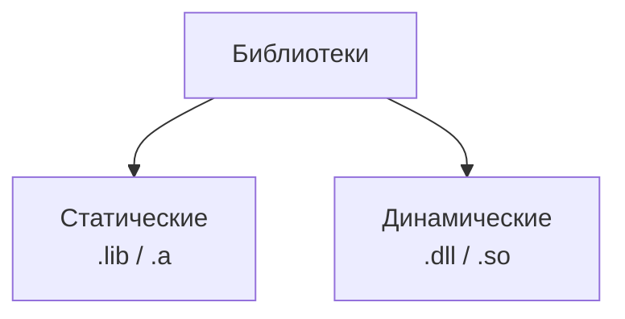

# Сборка и подключение библиотек

> [!abstract] О чём заметка
> Библиотека (library) — отдельный модуль с готовой функциональностью (классы, функции, переменные), который собирается один раз и подключается ко многим программам. Бывают два вида: статические (вшиваются в программу) и динамические (лежат отдельным файлом и загружаются при запуске). Разберём разницу, сборку в Visual Studio, в CMake и командной строкой g++.

## Зачем нужны библиотеки

**Библиотеки нужны, чтобы не писать один и тот же код дважды.** Допустим, вы написали набор классов для решения уравнений для консольного приложения, а потом понадобилось графическое приложение с теми же расчётами. Варианты:

- написать код заново — заведомо плохо;
- скопировать файлы — быстро, но при обнаружении ошибки править придётся в каждой копии;
- **собрать классы в библиотеку** и подключать её к разным проектам. Изменения вносятся один раз, пересобирается новая версия библиотеки и обновляется во всех проектах.

Для библиотеки нужны те же заголовочные файлы, что и в [[08 Многофайловые проекты и библиотеки]]: заголовок — интерфейс библиотеки, а код — в скомпилированном файле.



## Статические библиотеки

На Windows компилируются в файл `.lib` (на Linux — архив `.a`). **Статическая библиотека становится частью приложения: при линковке её код копируется внутрь `.exe`.** Поэтому библиотеку нужно собрать до сборки исполняемого файла.

```text
исходный код     компилятор   объектные файлы     линковщик      приложение .exe
приложения   ──────────────►  приложения     ──────────────►    (внутри — код
исходный код     компилятор   объектные файлы     ▲              библиотеки)
библиотеки   ──────────────►  библиотеки (.lib) ──┘
```

| Преимущества | Недостатки |
|---|---|
| распространять проще: всё в одном файле, не нужно «тащить» за собой файлы | большая библиотека увеличивает размер исполняемого файла |
| нет проблем с потерянной или не той версией библиотеки | для обновления библиотеки клиенту нужно отправить новый исполняемый файл всего приложения |
| | если библиотекой пользуются несколько модулей, она дублируется в каждом |

### Пример библиотеки и клиента

Библиотека с калькулятором в пространстве имён `MathPower` (о пространствах имён — [[10 Область видимости и пространства имён]]):

```cpp
// MathPower.h
#pragma once
namespace MathPower
{
    class Calculator
    {
    public:
        int Sum(int a, int b);
        int Sub(int a, int b);
    };
}
```

```cpp
// MathPower.cpp
#include "MathPower.h"
namespace MathPower
{
    int Calculator::Sum(int a, int b) { return a + b; }
    int Calculator::Sub(int a, int b) { return a - b; }
}
```

Приложение-клиент подключает заголовок и использует класс:

```cpp
// MathPowerClient.cpp
#include <iostream>
#include "MathPower.h"

int main()
{
    MathPower::Calculator c;
    std::cout << c.Sum(2, 3) << " " << c.Sub(10, 4) << std::endl;   // 5 6
}
```

### Сборка в Visual Studio

Порядок действий, показанный в курсе:

1. «Создание проекта» → фильтры C++, «Все платформы», «Библиотека» → «Мастер классических приложений Windows». Имя проекта `MathPowerLibraryStatic`.
2. В мастере: тип приложения **«Статическая библиотека (LIB)»**, галочка «Пустой проект». Добавить `MathPower.h` и `MathPower.cpp`, собрать решение.
3. Добавить в решение второй проект — «Консольное приложение» `MathPowerClient`; сделать его запускаемым («Назначить в качестве запускаемого проекта»).
4. Указать **зависимость**: у `MathPowerClient` правый клик по «Ссылки» → «Добавить ссылку» → «Проекты → Решение» → отметить библиотеку. Это заставляет линковщик подключить библиотеку.
5. Указать, **где искать заголовки**: «Свойства» проекта клиента → (конфигурация «Все конфигурации», платформа «Все платформы») → «C/C++» → «Общие» → «Дополнительные каталоги включаемых файлов» → добавить `$(SolutionDir)MathPowerLibraryStatic` и убедиться, что в «Вычисленном значении» лежит `MathPower.h`.
6. Подключить `MathPower.h` в `MathPowerClient.cpp` и использовать класс.

> [!note] Два независимых шага
> Ссылка на проект говорит **линковщику**, откуда брать скомпилированный код. Каталог включаемых файлов говорит **компилятору**, где лежат заголовки. Нужны оба. Если не хватает второго — ошибка `cannot open include file`, если первого — ошибка линковщика (`unresolved external symbol`).

### Статическая библиотека в CMake

CMake генерирует проекты сам, нужно лишь описать, чего вы хотите (подробнее о нём — [[10 CMake]]). Для исходников в одной папке в `CMakeLists.txt` добавляются две команды:

- `add_library(<имя> STATIC <файлы>)` — подобна `add_executable`, но указывает тип библиотеки;
- `target_link_libraries(<программа> <библиотека>...)` — связывает приложение с библиотекой.

```cmake
cmake_minimum_required(VERSION 3.22.0)
project(MathPower)

add_library(MathPowerStaticLib STATIC MathPower.h MathPower.cpp)

add_executable(MathPowerExe MathPowerClient.cpp)
target_link_libraries(MathPowerExe MathPowerStaticLib)
```

### Сборка вручную в g++ (Linux)

То, что делают IDE и CMake, можно повторить в терминале (проверено на этом примере):

```bash
g++ -std=c++17 -Wall -c MathPower.cpp -o MathPower.o     # скомпилировать библиотеку в объектный файл
ar rcs libmathpower.a MathPower.o                         # упаковать в статическую библиотеку (архив)
g++ -std=c++17 -Wall -I. -c MathPowerClient.cpp -o client.o   # -I. — где искать заголовки
g++ client.o -L. -lmathpower -o app                       # -L. — где искать библиотеки, -lmathpower -> libmathpower.a
./app                                                     # 5 6
```

Правило именования: файл называется `lib<имя>.a`, а в команде линковки пишется `-l<имя>` без `lib` и расширения.

## Динамические библиотеки

На Windows — файл `.dll` (на Linux — `.so`, на macOS — `.dylib`). **Динамическая библиотека лежит в собственном файле снаружи `.exe` и загружается во время работы приложения.** При сборке библиотеки на Windows дополнительно создаётся маленькая статическая **библиотека импорта** `.lib`: в неё записано, где в `.dll` искать нужные функции, и именно она подключается к приложению при линковке.

```text
приложение .exe                    динамическая библиотека .dll
┌───────────────────────┐   загрузка при запуске   ┌───────────────┐
│ код приложения        │ ───────────────────────► │ код библиотеки│
│ + библиотека импорта  │                           └───────────────┘
└───────────────────────┘
```

Сборка: код приложения → компилятор → объектные файлы → линковщик → `.exe`; код библиотеки → компилятор → объектные файлы → линковщик → `.dll` + «специальная информация» (библиотека импорта), которую использует линковщик приложения.

| Преимущества | Недостатки |
|---|---|
| размер `.exe` не растёт, даже если библиотека большая | распространять сложнее: потеря файла или неправильная версия `.dll` ломает программу |
| для обновления достаточно отдать новую (обратно совместимую) `.dll`, остальное не менять | |
| несколько модулей используют один файл библиотеки — экономия места и проще поддержка | |

### Экспорт символов в DLL

Компилятор Visual C++ **по умолчанию ничего не экспортирует** из DLL, а внешние модули должны видеть класс. Поэтому в заголовке используется специальный синтаксис:

```cpp
// DynamicMathPower.h
#pragma once
#ifdef MATHPOWERLIBRARYDYNAMIC_EXPORTS
    #define MATHPOWERLIBRARY_API __declspec(dllexport)
#else
    #define MATHPOWERLIBRARY_API __declspec(dllimport)
#endif

namespace DynamicMathPower
{
    class DynamicCalculator
    {
    public:
        MATHPOWERLIBRARY_API int Mult(int a, int b);
    };
}
```

Здесь работает условная компиляция из [[07 Препроцессор и макросы]]. Когда заголовок используется **при сборке самой библиотеки**, Visual Studio автоматически определяет макрос `<ИМЯПРОЕКТА>_EXPORTS` — и `MATHPOWERLIBRARY_API` превращается в `__declspec(dllexport)` (экспортировать). Когда его подключает **клиент**, макрос не определён — получается `__declspec(dllimport)` (импортировать).

Общее правило: ставить такой макрос в заголовках перед тем, что должно быть доступно извне: перед глобальными функциями, методами и полями класса. Если поставить его перед именем класса (`class MATHPOWERLIBRARY_API DynamicCalculator`), экспортируется весь класс со всеми членами.

```cpp
// DynamicMathPower.cpp
#include "DynamicMathPower.h"
namespace DynamicMathPower
{
    int DynamicCalculator::Mult(int a, int b) { return a * b; }
}
```

### Сборка в Visual Studio

Аналогично статической: добавить в решение пустой проект «Мастер классических приложений Windows» `MathPowerLibraryDynamic` с типом «Библиотека динамической компоновки (DLL)». Затем в клиенте — «Добавить ссылку» на новый проект и добавить `$(SolutionDir)MathPowerLibraryDynamic` в «Дополнительные каталоги включаемых файлов». Подключить `DynamicMathPower.h` и использовать `DynamicCalculator`.

### Динамическая библиотека в CMake

Добавляется ещё одна `add_library`, но с ключевым словом `SHARED`; идентификатор библиотеки дописывается в `target_link_libraries`:

```cmake
cmake_minimum_required(VERSION 3.22.0)
project(MathPower)

add_library(MathPowerStaticLib STATIC MathPower.h MathPower.cpp)
add_library(MathPowerDynamicLib SHARED DynamicMathPower.h DynamicMathPower.cpp)

add_executable(MathPowerExe MathPowerClient.cpp)
target_link_libraries(MathPowerExe MathPowerStaticLib MathPowerDynamicLib)
```

Чтобы **обойтись без `__declspec(dllexport/dllimport)`**, перед `add_library` ставят:

```cmake
set(CMAKE_WINDOWS_EXPORT_ALL_SYMBOLS ON)   # экспортировать из библиотеки всё (CMake сгенерирует .def-файл)
```

Эта переменная работает только для Windows-сборки с DLL.

### Сборка вручную в g++ (Linux)

В Linux `__declspec` не нужен: символы по умолчанию видны. Заголовок в нашем примере удобно сделать переносимым:

```cpp
#pragma once
#if defined(_WIN32)
  #ifdef MATHPOWERLIBRARYDYNAMIC_EXPORTS
    #define MATHPOWERLIBRARY_API __declspec(dllexport)
  #else
    #define MATHPOWERLIBRARY_API __declspec(dllimport)
  #endif
#else
  #define MATHPOWERLIBRARY_API
#endif
```

```bash
g++ -std=c++17 -Wall -fPIC -c DynamicMathPower.cpp -o Dyn.o    # -fPIC — позиционно-независимый код
g++ -shared Dyn.o -o libdynmathpower.so                        # собрать .so
g++ -std=c++17 -I. -c MathPowerClient.cpp -o client.o
g++ client.o -L. -lmathpower -ldynmathpower -o app

./app
# error while loading shared libraries: libdynmathpower.so: cannot open shared object file
LD_LIBRARY_PATH=. ./app            # Вывод: 5 6 42  (подсказали, где искать .so)
```

Пример показывает главный минус динамических библиотек: при запуске загрузчик ищет `.so`/`.dll` в определённых местах. Варианты решения:

| Платформа | Что сделать |
|---|---|
| Windows | положить `.dll` рядом с `.exe` (или в каталог из `PATH`) |
| Linux | переменная `LD_LIBRARY_PATH`, установка в системный каталог или встроенный путь: `-Wl,-rpath,'$ORIGIN'` при линковке |

Проверить, какие динамические библиотеки нужны программе, можно командой `ldd app` (Linux; в Windows — `dumpbin /dependents`).

> [!tip] Как выбрать вид библиотеки
> Нужна «одна коробка» без зависимостей → статическая. Одна библиотека используется несколькими программами или должна обновляться отдельно → динамическая.

## Частые ошибки

- Подключили заголовок, но не подключили саму библиотеку: компиляция проходит, линковка падает с `undefined reference` / `unresolved external symbol`.
- Подключили библиотеку, но не указали каталог заголовков: `cannot open include file`.
- Забыли экспортировать символы DLL (на Windows) — ошибка линковки, как будто функции нет.
- Программа собралась, но не запускается: рядом нет `.dll`/`.so` или это не та версия.
- Сборка клиента запущена раньше сборки библиотеки: библиотеку надо собрать первой (в IDE и CMake это задаётся зависимостью).

## Кратко (шпаргалка)

| | Статическая | Динамическая |
|---|---|---|
| Windows / Linux | `.lib` / `.a` | `.dll` (+ `.lib` импорта) / `.so` |
| Где код | внутри `.exe` | в отдельном файле, грузится при работе |
| Размер `.exe` | растёт | не меняется |
| Обновление | пересобрать и выдать всё приложение | заменить один файл (при совместимости) |
| Несколько модулей | копия в каждом | один общий файл |
| Минус | дублирование, большой размер | зависимость от наличия и версии файла |
| CMake | `add_library(X STATIC ...)` | `add_library(X SHARED ...)` |
| g++ | `ar rcs libX.a X.o` | `g++ -fPIC -c`, `g++ -shared` |

- К клиенту нужно подключить заголовки (`-I`, «Дополнительные каталоги включаемых файлов») **и** саму библиотеку (`-L -l`, «Ссылки», `target_link_libraries`).
- Для DLL в Visual C++ нужен `__declspec(dllexport/dllimport)` либо `CMAKE_WINDOWS_EXPORT_ALL_SYMBOLS`.

## Связанные темы
- [[08 Многофайловые проекты и библиотеки]] — заголовки и `.cpp`, из которых состоит библиотека.
- [[10 CMake]] — описание сборки библиотек и приложений одним файлом `CMakeLists.txt`.
- [[01 Компиляция и линковка]] — как линковщик связывает объектные файлы и библиотеки.
- [[07 Препроцессор и макросы]] — условная компиляция в макросе `MATHPOWERLIBRARY_API`.
