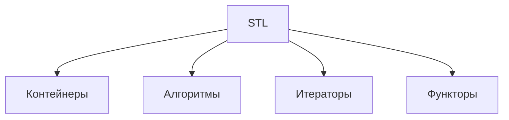

# STL, часть 1 — контейнеры

> [!abstract] О чём заметка
> **STL (Standard Template Library, стандартная библиотека шаблонов)** — набор готовых обобщённых контейнеров, алгоритмов, итераторов и функторов. В этой заметке разбираются контейнеры: как они устроены, какие у них методы и какой выбрать под задачу. Итераторы и алгоритмы — в [[07 STL часть 2]].

## Что такое STL

STL условно делится на четыре блока:



Контейнеры хранят данные, алгоритмы (`sort`, `find`, `transform`...) их обрабатывают, итераторы связывают первое со вторым, а функторы настраивают поведение алгоритмов (см. [[05 Шаблоны и функторы]]). Все контейнеры — **шаблоны классов**: `std::vector<int>`, `std::map<std::string, int>`.

Контейнеры бывают четырёх видов:

| Вид | Представители | Главная идея |
|---|---|---|
| Последовательные | `array`, `vector`, `deque`, `forward_list`, `list` | элементы расположены в порядке вставки, доступ по позиции |
| Ассоциативные | `set`, `map`, `multiset`, `multimap` | отсортированы по ключу, быстрый поиск $O(\log N)$ |
| Неупорядоченные ассоциативные | `unordered_set`, `unordered_map` и их multi-версии | хеш-таблица, поиск в среднем $O(1)$ |
| Адаптеры | `stack`, `queue`, `priority_queue` | урезанный интерфейс поверх другого контейнера |

## Последовательные контейнеры

### std::array

**`std::array<T, N>`** — массив фиксированного размера, известного на этапе компиляции. Это безопасная обёртка над C-массивом: сам управляет памятью, знает свой размер, элементы лежат в памяти **непрерывно**. Подключается через `<array>`.

| Метод | Описание |
|---|---|
| `at(i)` | доступ с проверкой границ (при выходе — исключение `std::out_of_range`) |
| `operator[]` | доступ без проверки (быстрее, но выход за границы — неопределённое поведение) |
| `front()`, `back()` | первый и последний элемент |
| `begin()`, `end()` | итераторы на начало и «за конец» |
| `empty()`, `size()` | пустота и количество элементов |
| `fill(v)` | заполнить значением |

```cpp
#include <array>
#include <iostream>
#include <stdexcept>

int main()
{
    std::array<int, 3> a1{1, 4, 5};
    std::array<char, 2> a2 = {'a', 'b'};
    a1[1] = 10;                 // 1 10 5
    a2.fill('d');               // d d
    for (const auto& x : a1) std::cout << x << " ";   // Вывод: 1 10 5
    std::cout << "\n";
    try { a1.at(5); }
    catch (const std::out_of_range&) { std::cout << "out_of_range\n"; }  // at бросает исключение
    // a1[5] — неопределённое поведение, без проверки
    std::cout << a1.front() << " " << a1.back() << " " << a1.size() << "\n";  // Вывод: 1 5 3
}
```

Все контейнеры поддерживают цикл `for` по диапазону (range-based for). Про исключения см. [[06 Исключения и обработка ошибок]].

### std::vector

**`std::vector<T>`** — динамический массив: размер заранее не известен и меняется. Элементы тоже лежат непрерывно, память управляется автоматически. Помимо методов `array`, добавляются:

| Метод | Описание |
|---|---|
| `push_back(x)` / `pop_back()` | добавить / удалить в конце |
| `insert(it, x)` | вставить перед позицией |
| `erase(it)` / `erase(first, last)` | удалить элемент или диапазон |
| `capacity()` | сколько элементов поместится в уже выделенную память |
| `shrink_to_fit()` | вернуть неиспользуемую память |

**Размер и ёмкость.** `size()` — сколько элементов лежит сейчас, `capacity()` — на сколько выделена память. Если при каждом `push_back` выделять новый блок и копировать все старые элементы, добавление было бы очень дорогим. Поэтому память выделяется **с запасом**, а при исчерпании ёмкости вектор выделяет блок больше (обычно в 1,5–2 раза), копирует/переносит элементы и освобождает старый. Благодаря этому `push_back` в среднем работает за $O(1)$ (амортизированно).

```cpp
std::vector<int> v = {7, 5, 16, 8};     // size = 4, capacity = 4
v.push_back(10);                        // size = 5, capacity = 8 (в GCC; у других реализаций иначе)
v.push_back(16);
v.pop_back();                           // 7 5 16 8 10
v.erase(v.begin() + 1);                 // 7 16 8 10
v.insert(v.begin() + 1, 99);            // 7 99 16 8 10
```

> [!note] Ёмкость зависит от реализации
> В слайдах после `push_back` указана ёмкость 6, но стандарт не фиксирует коэффициент роста. В GCC/libstdc++ ёмкость удваивается: рост при добавлении элементов в пустой вектор — `1 2 4 8 16 32` (проверено). Рассчитывать на конкретное число нельзя.

**Инвалидация ссылок.** Когда вектор перевыделяет память, **все указатели, ссылки и итераторы на его элементы становятся недействительными**: старый блок освобождён, элементы переехали. Использовать их — неопределённое поведение.

```cpp
std::vector<int> w = {1, 2, 3};
int* p = &w[0];
w.reserve(1000);          // перевыделение памяти
// p теперь висячий указатель — обращаться к *p нельзя
```

> [!tip] Если размер известен заранее
> `v.reserve(n)` выделяет память один раз и избавляет от перевыделений при последующих `push_back`.

### std::deque

**`std::deque<T>`** (double-ended queue, двусторонняя очередь) — быстро добавляет и удаляет элементы **с обоих концов**. Элементы хранятся не одним блоком, а в нескольких отдельных массивах фиксированного размера, поэтому рост дешевле (достаточно добавить новый блок, не копируя старые), а индексация чуть медленнее, чем у вектора. Методы — как у вектора плюс `push_front` / `pop_front`.

```cpp
std::deque<int> d = {7, 5, 16, 8};
d.push_back(10);       // 7 5 16 8 10
d.push_front(16);      // 16 7 5 16 8 10
d.pop_back();          // 16 7 5 16 8
d.pop_front();         // 7 5 16 8
```

### std::forward_list

**`std::forward_list<T>`** — односвязный список: каждый элемент хранится в отдельном блоке памяти и знает только следующего. Итерация возможна лишь вперёд. Вставка и удаление в произвольном месте — быстрые ($O(1)$, если позиция известна), но доступа по индексу нет.

Так как вставлять можно только *после* заданного элемента, методы называются `insert_after`, `erase_after`; для вставки в начало есть `before_begin()`. Также есть `push_front`, `pop_front`, `remove`, `unique`, `sort` (у списков сортировка — метод, а не `std::sort`, потому что нужен произвольный доступ).

```cpp
std::forward_list<int> fl = {1, 5, 4, 2, 3};
fl.sort();                                              // 1 2 3 4 5
fl.insert_after(fl.before_begin(), {6, 7, 8});          // 6 7 8 1 2 3 4 5
fl.insert_after(std::find(fl.begin(), fl.end(), 2), 5); // 6 7 8 1 2 5 3 4 5
```

### std::list

**`std::list<T>`** — двусвязный список: можно ходить в обе стороны. Свойства те же: быстрая вставка и удаление в любом месте, но нет индексации и плохая работа с кэшем процессора (элементы разбросаны по памяти). Методы: `push_front/back`, `pop_front/back`, `insert`, `erase`, `remove`, `unique`, `sort`.

> [!warning] Исправление относительно слайдов
> `list.insert(it, x)` вставляет **перед** `it`. В слайдах результат вставки пятёрки на позицию двойки был указан как `6 7 8 1 2 5 3 4 5` (так работает `forward_list::insert_after`), а у `std::list` реальный результат — `6 7 8 1 5 2 3 4 5`.

```cpp
std::list<int> l = {1, 5, 4, 2, 3};
l.sort();                                      // 1 2 3 4 5
l.insert(l.begin(), {6, 7, 8});                // 6 7 8 1 2 3 4 5
l.insert(std::find(l.begin(), l.end(), 2), 5); // 6 7 8 1 5 2 3 4 5   (перед двойкой)
l.remove(5);                                   // удалены все пятёрки: 6 7 8 1 2 3 4
```

Подробнее об устройстве массивов и списков — в [[04 Динамический массив, списки, деки]].

### Какой последовательный контейнер выбрать

| Контейнер | Доступ по индексу | Вставка в середину | Вставка в начало/конец | Память |
|---|---|---|---|---|
| `array` | $O(1)$ | — (размер фиксирован) | — | непрерывно |
| `vector` | $O(1)$ | $O(N)$ | конец $O(1)$ (амортиз.), начало $O(N)$ | непрерывно |
| `deque` | $O(1)$ | $O(N)$ | оба конца $O(1)$ | блоками |
| `list` / `forward_list` | нет | $O(1)$ по известной позиции | $O(1)$ | узел на элемент |

По умолчанию берите `std::vector`: он быстр и компактен; остальные — когда есть конкретная причина.

## Ассоциативные контейнеры

Хранят элементы **упорядоченно** (по умолчанию по возрастанию ключа) и обеспечивают быстрый поиск за $O(\log N)$ (внутри обычно красно-чёрное дерево, см. [[05 Пирамиды и деревья поиска]]). Для типа ключа должен быть определён `operator<` (или передан свой компаратор — функтор!).

| Контейнер | Что хранит | Дубликаты |
|---|---|---|
| `std::set` | множество ключей | нет |
| `std::multiset` | множество ключей | да |
| `std::map` | пары ключ-значение | ключи уникальны |
| `std::multimap` | пары ключ-значение | ключи могут повторяться |

Общие методы: `empty`, `clear`, `insert`, `erase`, `count` (сколько элементов с таким ключом), `find` (итератор на элемент или `end()`), `lower_bound` (первый элемент **не меньше** заданного), `upper_bound` (первый элемент **больше** заданного).

### std::set

```cpp
#include <iostream>
#include <set>

int main()
{
    std::set<int> s;
    s.insert(10);
    s.insert(5);
    s.insert(6);
    s.insert(6);                                   // дубликат игнорируется
    for (const auto& x : s) std::cout << x << " "; // Вывод: 5 6 10 (отсортировано)
    std::cout << "\n";
    std::cout << *s.lower_bound(7) << "\n";        // Вывод: 10 (первый >= 7)
    std::cout << *s.upper_bound(6) << "\n";        // Вывод: 10 (первый > 6)
    std::cout << s.count(6) << "\n";               // Вывод: 1
}
```

Перед разыменованием результата `lower_bound`/`find` сравнивайте его с `s.end()`.

### std::map

**`std::map<K, V>`** — словарь: каждому уникальному ключу соответствует значение; элементы хранятся как `std::pair<const K, V>`, поэтому `elem.first` — ключ, `elem.second` — значение.

```cpp
#include <iostream>
#include <map>
#include <string>

int main()
{
    std::map<std::string, int> m{{"CPU", 10}, {"GPU", 15}, {"RAM", 20}};
    m["CPU"] = 25;       // изменили существующее
    m["SSD"] = 30;       // ключа не было — вставили
    m.erase("GPU");
    for (const auto& [key, val] : m)
        std::cout << key << ": " << val << "\n";
    // Вывод:
    // CPU: 25
    // RAM: 20
    // SSD: 30
    std::cout << m.count("GPU") << " " << m.size() << "\n";   // Вывод: 0 3
    std::cout << m["XXX"] << " " << m.size() << "\n";         // Вывод: 0 4
}
```

> [!warning] operator[] вставляет
> Обращение `m["XXX"]` к несуществующему ключу **создаёт** элемент со значением по умолчанию (`0` для `int`) — размер вырос с 3 до 4. Чтобы только проверить наличие, используйте `find` или `count`; чтобы прочитать без вставки — `at` (бросит исключение).

## Неупорядоченные ассоциативные контейнеры

`std::unordered_set`, `std::unordered_map`, `std::unordered_multiset`, `std::unordered_multimap` имеют те же методы, но хранят элементы в **хеш-таблице** (см. [[06 Хеширование]]), а не в отсортированном виде. Поиск, вставка и удаление в среднем $O(1)$, в худшем случае (много коллизий) $O(N)$. Для ключа нужна хеш-функция и `operator==`.

> [!warning] Порядок обхода не определён
> Порядок элементов при переборе `unordered_*` не гарантирован и может отличаться между компиляторами и запусками. Если нужен стабильный вывод — копируйте в вектор и сортируйте, как в примере.

```cpp
#include <algorithm>
#include <iostream>
#include <string>
#include <unordered_map>
#include <unordered_set>
#include <vector>

int main()
{
    std::unordered_map<std::string, int> um{{"a", 1}, {"b", 2}, {"c", 3}};
    std::vector<std::pair<std::string, int>> tmp(um.begin(), um.end());
    std::sort(tmp.begin(), tmp.end());                 // порядок обхода um не гарантирован
    for (auto& p : tmp) std::cout << p.first << "=" << p.second << " ";  // Вывод: a=1 b=2 c=3
    std::cout << "\n";
    std::unordered_set<int> us{3, 1, 2};
    std::cout << us.count(2) << us.count(9) << "\n";   // Вывод: 10
}
```

Выбор: нужен порядок или поиск по диапазону (`lower_bound`) — `map`/`set`; важна только скорость поиска по ключу — `unordered_*`.

## Адаптеры контейнеров

**Адаптер (container adapter)** не хранит данные сам, а оборачивает последовательный контейнер (по умолчанию `deque` или `vector`) и показывает урезанный интерфейс. У адаптеров нет итераторов и обхода.

### std::stack

**Стек** работает по принципу **LIFO (Last In, First Out)**: последний добавленный элемент извлекается первым. Методы: `push`, `pop` (удаляет, ничего не возвращая), `top` (элемент на вершине), `empty`, `size`.

```cpp
std::stack<int> st;
st.push(5);
st.push(15);        // 5 15
st.push(2);         // 5 15 2
st.pop();           // 5 15
// st.top() == 15
```

### std::queue

**Очередь** — **FIFO (First In, First Out)**: первым извлекается тот, кто пришёл первым. Добавление в конец, удаление с начала. Методы: `push`, `pop`, `front`, `back`, `empty`, `size`.

```cpp
std::queue<int> q;
q.push(5); q.push(15); q.push(7);   // 5 15 7
// q.back() == 7, q.front() == 5
q.pop();                            // 15 7
```

### std::priority_queue

**Очередь с приоритетом** — на вершине всегда лежит «наибольший» элемент (по умолчанию), доступный за $O(1)$; вставка и извлечение — $O(\log N)$ (внутри двоичная куча, см. [[05 Пирамиды и деревья поиска]]). Методы: `push`, `pop`, `top`, `empty`, `size`. Для минимума передают компаратор `std::greater`.

```cpp
std::priority_queue<int> pq;
for (int x : {3, 9, 1, 7}) pq.push(x);
while (!pq.empty()) { std::cout << pq.top() << " "; pq.pop(); }   // Вывод: 9 7 3 1

std::priority_queue<int, std::vector<int>, std::greater<int>> mn;  // минимум наверху
for (int x : {3, 9, 1, 7}) mn.push(x);
// mn.top() == 1
```

> [!note] Уточнение
> В слайдах сказано, что элементы «сортируются при вставке». На самом деле полной сортировки нет — поддерживается только свойство кучи (корень максимальный), этого достаточно для $O(\log N)$.

## Задачи для практики

- Прочитайте слова из ввода и посчитайте частоту каждого. *Решение:* `std::map<std::string, int>`, для каждого слова `++m[word]`.
- Выведите уникальные числа из массива по возрастанию. *Решение:* положить в `std::set<int>` и обойти.
- Проверьте правильность скобочной последовательности `([]{})`. *Решение:* `std::stack<char>`: открывающие кладём, на закрывающей сверяем с `top` и делаем `pop`.
- Найдите три наибольших числа потока. *Решение:* `priority_queue` с `greater` размера не более 3.

## Частые ошибки

- `operator[]` у `map` для проверки наличия ключа — вставляет элемент.
- Использование ссылок/итераторов на элементы `vector` после `push_back` / `insert` (инвалидация).
- `v[i]` вместо `v.at(i)` при выходе за границы — неопределённое поведение.
- `std::sort` для `std::list` / `forward_list` — не скомпилируется, нужен метод `list.sort()`.
- Ожидание порядка в `unordered_*`.
- `stack::pop()` / `queue::pop()` ничего не возвращают — значение берут заранее через `top()` / `front()`.

## Кратко (шпаргалка)

| Задача | Контейнер |
|---|---|
| Массив фиксированной длины | `std::array` |
| Универсальный динамический массив | `std::vector` |
| Быстрое добавление с обоих концов | `std::deque` |
| Частые вставки/удаления в середине | `std::list` (`forward_list` — экономнее) |
| Уникальные отсортированные значения | `std::set` |
| Словарь с порядком ключей | `std::map` |
| Словарь без порядка, максимум скорости | `std::unordered_map` |
| LIFO / FIFO / максимум | `stack` / `queue` / `priority_queue` |

## Ссылки
- Документация по контейнерам: cppreference.com, раздел «Containers library».

## Связанные темы
- [[05 Шаблоны и функторы]] — контейнеры STL являются шаблонами, компараторы — функторами.
- [[07 STL часть 2]] — итераторы и алгоритмы для работы с контейнерами.
- [[04 Динамический массив, списки, деки]] — как устроены `vector`, `list`, `deque` внутри.
- [[06 Хеширование]] — принцип работы `unordered_*` контейнеров.
- [[07 Указатели и массивы]] — C-массивы, на смену которым приходит `std::array`.
