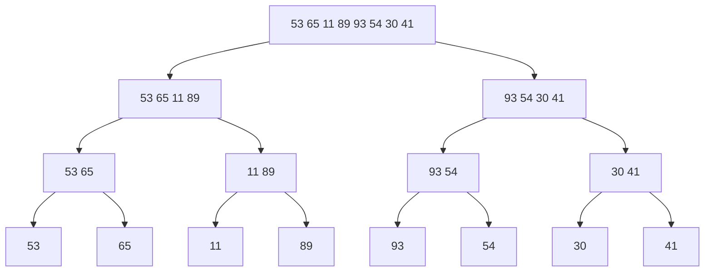

# Сортировки

> [!abstract] О чём заметка
> **Сортировка** (sorting) — алгоритм, упорядочивающий элементы массива по возрастанию или убыванию. Это одна из самых изученных задач: на ней видно, как выбор алгоритма меняет время работы с «3,5 лет» до «минуты». Заметка разбирает сортировки пузырьком, слиянием, быструю (Хоара) и подсчётом, вводит понятия устойчивости и адаптивности и заканчивается сравнительной таблицей.

Нужны оценки сложности из [[01 Алгоритмическая сложность]] и рекурсия ([[05 Функции и рекурсия]]).

## Постановка задачи

Дан массив `53 65 11 89 93 54 30 41`. Нужно получить массив, упорядоченный от меньшего к большему: `11 30 41 53 54 65 89 93`.

Во всех примерах ниже будем сортировать именно этот массив (или его часть).

## Сортировка пузырьком

**Идея.** Пройдём по массиву, сравнивая соседние пары `arr[i]` и `arr[i+1]`. Если левый больше правого — меняем их местами (swap). За один такой проход самый большой элемент «всплывает» в конец, как пузырёк. Повторяем проход, каждый раз не затрагивая уже всплывшие элементы справа.

Трассировка на `29 10 14 37 13`:

| Проход | Что происходит | Массив после прохода |
|---|---|---|
| 1 | 29>10 своп; 29>14 своп; 29<37 нет; 37>13 своп | `10 14 29 13 37` |
| 2 | 10<14 нет; 14<29 нет; 29>13 своп | `10 14 13 29 37` |
| 3 | 10<14 нет; 14>13 своп | `10 13 14 29 37` |
| 4 | 10<13 нет | `10 13 14 29 37` |

Псевдокод:

```text
for i от 0 до n-2
    for j от 0 до n-i-2
        if arr[j] > arr[j+1]
            swap arr[j] arr[j+1]
```

```cpp
#include <iostream>
#include <vector>
#include <utility>
using namespace std;

void bubbleSort(vector<int>& a) {
    int n = a.size();
    for (int i = 0; i < n - 1; ++i) {
        bool swapped = false;
        for (int j = 0; j < n - i - 1; ++j)          // последние i элементов уже на месте
            if (a[j] > a[j + 1]) { swap(a[j], a[j + 1]); swapped = true; }
        if (!swapped) break;                          // обменов не было — массив уже отсортирован
    }
}

int main() {
    vector<int> a = {53, 65, 11, 89, 93, 54, 30, 41};
    bubbleSort(a);
    for (int x : a) cout << x << ' ';                 // Вывод: 11 30 41 53 54 65 89 93
    cout << "\n";
}
```

**Сложность.** Один проход — $O(n)$ (константная итерация по массиву), проходов порядка $n$, итого время $O(n^2)$, дополнительная память $O(1)$. Сортировки за квадратичное время называют **квадратичными**, и для больших $n$ они считаются слишком медленными. Флажок `swapped` (в слайдах его нет) делает алгоритм **адаптивным**: на уже отсортированном массиве хватит одного прохода, $O(n)$.

## Сортировка слиянием

### Операция слияния

**Слияние** (merge) — соединение двух отсортированных массивов в один отсортированный. Заведём по счётчику на каждый входной массив и на каждом шаге будем брать меньший из двух «текущих» элементов.

Разбор: $A = [1, 4, 9]$, $B = [2, 3, 10, 11]$:

| Шаг | `A[ia]` | `B[ib]` | Берём | `C` |
|---|---|---|---|---|
| 1 | 1 | 2 | 1 | 1 |
| 2 | 4 | 2 | 2 | 1 2 |
| 3 | 4 | 3 | 3 | 1 2 3 |
| 4 | 4 | 10 | 4 | 1 2 3 4 |
| 5 | 9 | 10 | 9 | 1 2 3 4 9 |
| 6 | (A кончился) | 10 | 10 | 1 2 3 4 9 10 |
| 7 | | 11 | 11 | 1 2 3 4 9 10 11 |

```cpp
#include <vector>
using namespace std;

vector<int> mergeArrays(const vector<int>& A, const vector<int>& B) {
    vector<int> C;
    C.reserve(A.size() + B.size());
    size_t ia = 0, ib = 0;
    while (ia < A.size() || ib < B.size()) {
        if (ia == A.size())      C.push_back(B[ib++]);   // A закончился
        else if (ib == B.size()) C.push_back(A[ia++]);   // B закончился
        else if (A[ia] <= B[ib]) C.push_back(A[ia++]);   // <= : при равенстве берём из A — устойчивость
        else                     C.push_back(B[ib++]);
    }
    return C;
}
```

**Сложность слияния.** Итерация цикла занимает константное время, а их ровно $|A| + |B|$ (на каждой шаге один из счётчиков растёт). Если суммарно $n$ элементов — время $O(n)$. Память: результат $C$ размера $n$, то есть $O(n)$.

### Рекурсивная сортировка

**Идея** (разделяй и властвуй, divide and conquer):

1. массив из одного элемента уже отсортирован;
2. иначе делим массив пополам;
3. рекурсивно сортируем каждую половину;
4. сливаем две отсортированные половины.

```text
merge_sort(arr):
    if длина(arr) == 1: return arr
    left, right = разбить arr пополам
    return merge(merge_sort(left), merge_sort(right))
```

Разбор на `53 65 11 89 93 54 30 41`:



Слияния идут снизу вверх: `[53 65]`, `[11 89]` → `[11 53 65 89]`; `[54 93]`, `[30 41]` → `[30 41 54 93]`; итог: `[11 30 41 53 54 65 89 93]`.

```cpp
#include <iostream>
#include <vector>
using namespace std;

vector<int> mergeArrays(const vector<int>& A, const vector<int>& B);   // из предыдущего раздела

vector<int> mergeSort(const vector<int>& a) {
    if (a.size() <= 1) return a;                       // база рекурсии
    size_t mid = a.size() / 2;
    vector<int> L(a.begin(), a.begin() + mid);
    vector<int> R(a.begin() + mid, a.end());
    return mergeArrays(mergeSort(L), mergeSort(R));
}
```

(Для самостоятельного запуска дополните программу определением `mergeArrays` и `main`: `mergeSort({53,65,11,89,93,54,30,41})` даёт `11 30 41 53 54 65 89 93`.)

**Сложность — подсчёт по уровням рекурсии.**

- Один вызов на куске длины $w$ (без учёта вложенных) стоит $O(w)$ из-за слияния.
- На $k$-м уровне рекурсии $2^k$ вызовов, каждый на куске длиной примерно $n / 2^k$. Суммарно $2^k \cdot n/2^k = n$ — **каждый уровень стоит $O(n)$**.
- Уровней $\log_2 n$ (столько раз можно разделить $n$ пополам).

Итого время $O(n \log n)$, дополнительная память $O(n)$ (под слияние). Для $10^9$ элементов это порядка минуты вместо 3,5 лет у пузырька. Сортировка слиянием **устойчива**, а время $O(n\log n)$ гарантировано при любом входе.

## Быстрая сортировка (quicksort)

### Пивотирование

**Идея.** Выберем в массиве **опорный элемент** (pivot) и перераспределим элементы так, чтобы слева от некоторой границы все элементы были не больше опоры, а справа — не меньше. Это **пивотирование** (partition). Опору выбирают случайно.

Алгоритм со счётчиками (схема Хоара): `left` идёт слева, пока элементы меньше опоры; `right` идёт справа, пока элементы больше опоры. Если счётчики ещё не встретились — меняем найденные элементы местами и двигаем счётчики навстречу; иначе — граница найдена.

Разбор на `53 65 11 89 93 54 30 41`, опора — значение 54:

| Шаг | `left` остановился на | `right` остановился на | Действие | Массив |
|---|---|---|---|---|
| 1 | 1 (65 ≥ 54) | 7 (41 ≤ 54) | своп | `53 41 11 89 93 54 30 65` |
| 2 | 3 (89) | 6 (30) | своп | `53 41 11 30 93 54 89 65` |
| 3 | 4 (93) | 5 (54) | своп | `53 41 11 30 54 93 89 65` |
| 4 | 5 (93) | 4 (54) | счётчики разошлись — граница после индекса 4 | |

Слева от границы (индексы 0–4) все элементы $\le 54$, справа (5–7) — $\ge 54$. Время пивотирования $O(n)$ (каждый элемент просматривается один раз), память $O(1)$.

### Рекурсия

Если массив из одного элемента — ничего не делаем. Иначе делаем пивотирование и рекурсивно сортируем левую и правую части. Части передаём не копиями, а парой индексов `[lo, hi]` исходного массива — так не нужна дополнительная память. Сортировки, не требующие $O(n)$ дополнительной памяти, называют **сортировками на месте** (in-place).

```cpp
#include <iostream>
#include <random>
#include <utility>
#include <vector>
using namespace std;

mt19937 rng(42);

// Разбиение Хоара по значению опоры. Возвращает j: [lo..j] <= pivot <= [j+1..hi]
int partition(vector<int>& a, int lo, int hi) {
    int pivot = a[lo + rng() % (hi - lo)];     // случайная опора из [lo, hi-1]
    int i = lo - 1, j = hi + 1;
    while (true) {
        do ++i; while (a[i] < pivot);          // left: пропускаем меньшие
        do --j; while (a[j] > pivot);          // right: пропускаем большие
        if (i >= j) return j;                  // счётчики встретились
        swap(a[i], a[j]);
    }
}

void quickSort(vector<int>& a, int lo, int hi) {
    if (lo >= hi) return;
    int j = partition(a, lo, hi);
    quickSort(a, lo, j);
    quickSort(a, j + 1, hi);
}

int main() {
    vector<int> a = {53, 65, 11, 89, 93, 54, 30, 41};
    quickSort(a, 0, (int)a.size() - 1);
    for (int x : a) cout << x << ' ';          // Вывод: 11 30 41 53 54 65 89 93
    cout << "\n";
}
```

> [!warning] Тонкость границ
> Опору случайно берём из `[lo, hi-1]`, а не из всего отрезка: при схеме Хоара выбор максимума на последнем месте мог бы вернуть `j == hi`, и рекурсия `quickSort(a, lo, j)` не сократила бы задачу — бесконечная рекурсия. В слайдах пивотирование записано упрощённо; перенося его в код, внимательно проверяйте, что обе части строго меньше исходной.

**Сложность.** Если опора случайна, то в среднем массив делится примерно пополам на каждом шаге: глубина $O(\log n)$, на каждом уровне суммарно $O(n)$ — в среднем $O(n \log n)$. В худшем случае (опора каждый раз почти минимум или максимум) глубина доходит до $n$ и время становится $O(n^2)$, но случайный выбор делает это маловероятным. Память: сами данные не копируются, остаётся стек рекурсии (в среднем $O(\log n)$; в таблице слайдов — $O(1)$ как «на месте»).

**Неустойчивость.** Быстрая сортировка **не устойчива**: своп далёких элементов может поменять порядок равных. Пример: `[2a, 2b, 1]` с опорой 2 — своп `2a` и `1` даёт `[1, 2b, 2a]`, равные двойки поменялись местами.

## Линейные сортировки: сортировка подсчётом

**Сортировка на сравнениях** (comparison sort) использует только операцию «сравнить два элемента» и ничего не знает о значениях. Слияние и быстрая сортировка — такие алгоритмы; быстрее $O(n \log n)$ они не умеют.

Если известна дополнительная информация, можно быстрее. Пример: все значения — целые из маленького диапазона $0 \dots K-1$. Тогда применима **сортировка подсчётом** (count sort):

1. завести массив `counts` длины $K$ и за один проход посчитать, сколько раз встретилось каждое значение;
2. пройти по `counts` и записать каждое значение в результат столько раз, сколько оно встретилось.

Разбор: `2 5 3 8 9 4 2 1 5 3 9 2 4 5` ($K = 10$):

| Значение | 0 | 1 | 2 | 3 | 4 | 5 | 6 | 7 | 8 | 9 |
|---|---|---|---|---|---|---|---|---|---|---|
| `counts` | 0 | 1 | 3 | 2 | 2 | 3 | 0 | 0 | 1 | 2 |

Выписываем: `1, 2 2 2, 3 3, 4 4, 5 5 5, 8, 9 9`.

```cpp
#include <iostream>
#include <vector>
using namespace std;

void countSort(vector<int>& a, int K) {          // значения в диапазоне 0..K-1
    vector<int> counts(K, 0);
    for (int x : a) ++counts[x];                 // первый проход: O(n)
    int idx = 0;
    for (int v = 0; v < K; ++v)                  // второй проход: O(n + K)
        while (counts[v]-- > 0) a[idx++] = v;
}

int main() {
    vector<int> a = {2, 5, 3, 8, 9, 4, 2, 1, 5, 3, 9, 2, 4, 5};
    countSort(a, 10);
    for (int x : a) cout << x << ' ';            // Вывод: 1 2 2 2 3 3 4 4 5 5 5 8 9 9
    cout << "\n";
}
```

**Сложность.** Время $O(n + K)$, память $O(K)$. Если $K$ мал по сравнению с $n$, это линейная сортировка. Но при диапазоне вроде $10^9$ массив `counts` не поместится в память — метод неприменим. В этой простой версии мы записываем значения заново, поэтому понятие устойчивости теряет смысл (числа неразличимы); для сортировки объектов по ключу используют префиксные суммы счётчиков, и тогда подсчёт можно сделать устойчивым.

## Свойства сортировок

**Устойчивость** (stability). Сортировка **устойчива**, если элементы, равные с точки зрения сравнения, сохраняют относительный порядок. Сортируем товары по цене:

```text
До:      Хлеб 50р, Мука 30р, Рыба 50р
Устойчивая:     Мука 30р, Хлеб 50р, Рыба 50р     (Хлеб остался перед Рыбой)
Неустойчивая:   Мука 30р, Рыба 50р, Хлеб 50р     (порядок Хлеб/Рыба нарушен)
```

Это важно при многоключевой сортировке: сначала по одному полю, потом устойчиво по другому. Слияние устойчиво, быстрая сортировка — нет. В STL для этого есть `std::stable_sort` ([[06 STL часть 1]]).

**Адаптивность** (adaptivity). Сортировка адаптивна, если на почти отсортированных данных работает быстрее. Пример из лекции: `54 1 33 4 80 72 13` — около 50 шагов, `1 13 4 54 33 72 80` — около 6. Пузырёк с флагом `swapped` адаптивен; слияние и быстрая сортировка в простом виде — нет.

## Сравнительная таблица

| Сортировка | Время (лучшее) | Время (среднее) | Время (худшее) | Доп. память | Устойчивость |
|---|---|---|---|---|---|
| Пузырьком | $O(n)$ (с флагом `swapped`) | $O(n^2)$ | $O(n^2)$ | $O(1)$ | да |
| Слиянием | $O(n \log n)$ | $O(n \log n)$ | $O(n \log n)$ | $O(n)$ | да |
| Быстрая (случайная опора) | $O(n \log n)$ | $O(n \log n)$ | $O(n^2)$ | $O(1)$ на месте (+ стек $O(\log n)$ в среднем) | нет |
| Подсчётом | $O(n + K)$ | $O(n + K)$ | $O(n + K)$ | $O(K)$ | понятие теряет смысл (для простой версии) |

Здесь $K$ — размер диапазона значений. Без дополнительных флагов пузырёк делает $O(n^2)$ всегда; в слайдах приведено значение $O(n^2)$.

> [!tip] Какую сортировку выбрать
> - Общий случай — `std::sort` из STL ([[06 STL часть 1]]): быстрая сортировка с улучшениями.
> - Нужна устойчивость и гарантированное время — слияние (`std::stable_sort`).
> - Значения целые и из малого диапазона — подсчётом.
> - Пузырёк — учебный пример; на практике не используется.

## Частые ошибки

- **Забыть базу рекурсии** (массив длины 0 или 1) — бесконечная рекурсия.
- **Выбирать опору в быстрой сортировке всегда первым/последним элементом:** на отсортированных данных получается $O(n^2)$.
- **Неверные границы** в пивотировании и разбиении (`<` вместо `<=`, части не уменьшаются).
- **Использовать `<` вместо `<=` при слиянии** и потерять устойчивость.
- **Применять подсчёт к большому диапазону** или к отрицательным числам без сдвига.
- **Путать «на месте» и «устойчивая»:** это независимые свойства.

## Задачи для практики

1. Отсортировать вручную `29 10 14 37 13` пузырьком; сколько проходов нужно? *Ответ: 3 значимых, четвёртый без обменов.*
2. Слить `[1, 4, 9]` и `[2, 3, 10, 11]`. *Ответ: `1 2 3 4 9 10 11`.*
3. Почему слияние требует $O(n)$ памяти, а быстрая сортировка — нет? *Ответ: слияние пишет результат в новый массив; пивотирование переставляет элементы на месте.*
4. Отсортировать `3 1 2 3 1 0 2` подсчётом. *Ответ: `counts = [1,2,2,2]` → `0 1 1 2 2 3 3`.*
5. Приведите массив, на котором быстрая сортировка с первым элементом в качестве опоры работает за $O(n^2)$. *Ответ: уже отсортированный.*

## Кратко (шпаргалка)

- Пузырёк: всплывание максимума, $O(n^2)$, $O(1)$ памяти, устойчив, с флагом адаптивен.
- Слияние: делим пополам, сортируем, сливаем; $O(n\log n)$ всегда, $O(n)$ памяти, устойчива.
- Быстрая: пивотирование + рекурсия; в среднем $O(n\log n)$, худший $O(n^2)$, на месте, неустойчива.
- Подсчётом: для малого диапазона $0..K-1$, $O(n+K)$, $O(K)$ памяти.
- Сортировки на сравнениях быстрее $O(n\log n)$ не бывают.
- Устойчивость — порядок равных; адаптивность — выигрыш на почти отсортированных данных.

## Ссылки

- VisuAlgo — визуализация сортировок: https://visualgo.net/en/sorting (разделы BUB, MER, QUI).
- В лекции также использовались анимации «Bubble Sort» и «Merge Sort — Sorting Algorithm Animations».

## Связанные темы

- [[01 Алгоритмическая сложность]] — оценки $O(n^2)$ и $O(n\log n)$ и способ подсчёта по уровням.
- [[02 Динамическое программирование и жадные алгоритмы]] — другой способ избежать лишней работы: запоминание ответов.
- [[04 Динамический массив, списки, деки]] — контейнеры, которые сортируются этими алгоритмами.
- [[05 Пирамиды и деревья поиска]] — пирамидальная сортировка: ещё один $O(n\log n)$ алгоритм.
- [[06 STL часть 1]] — `std::sort`, `std::stable_sort`.
